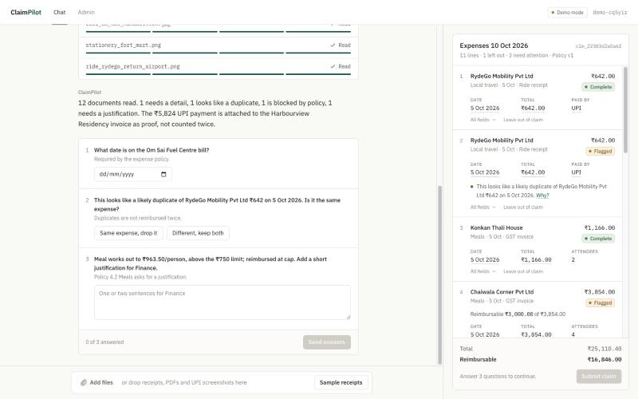
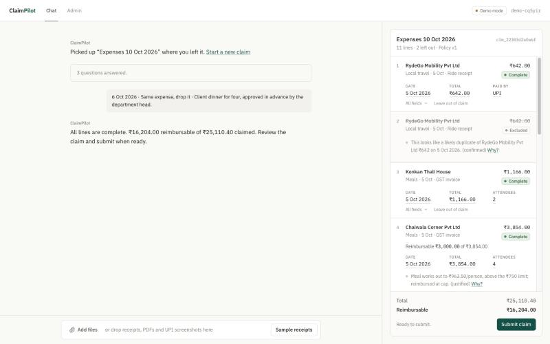
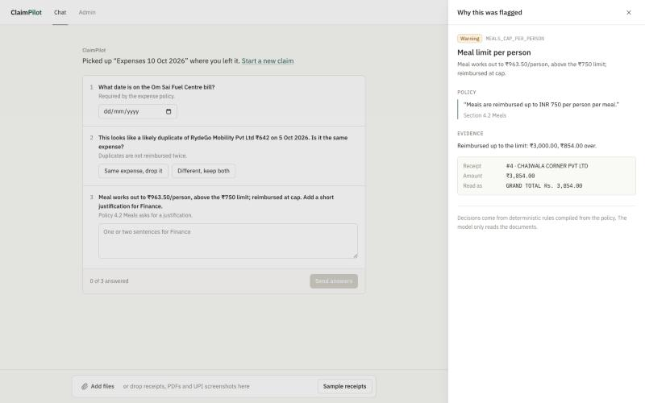
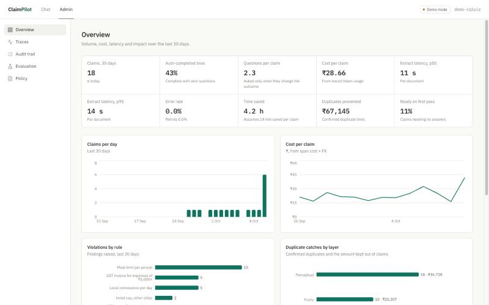
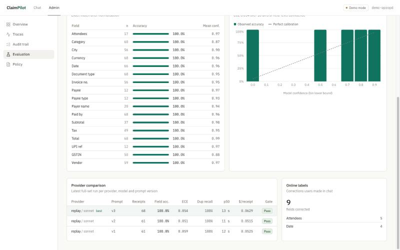
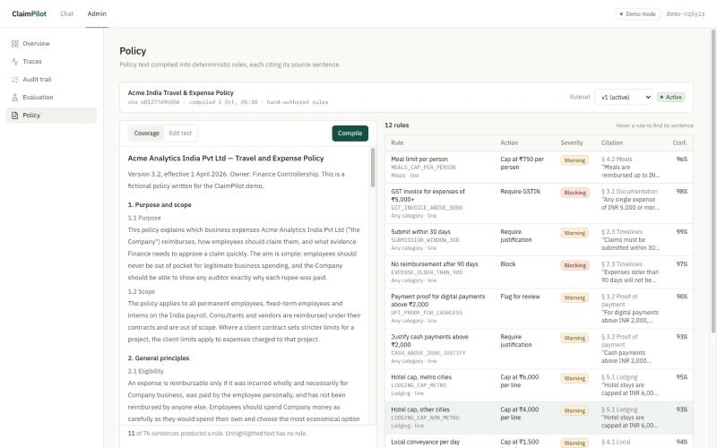
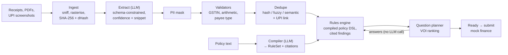

# ClaimPilot

**An AI expense and reimbursement agent. The LLM perceives, the code decides.**

Jio AI Innovation Lab, Season 2, Round 2. Track: **Business case 1: Expense & Reimbursement Agent**.

Employees drop receipt photos, PDFs and UPI payment screenshots into a chat. ClaimPilot reads every document with a vision model into structured fields (each with a confidence score and the exact text it was read from), applies the company expense policy with a deterministic rules engine, catches duplicates three different ways, links UPI screenshots to the bills they paid, asks only the questions that would change the outcome, and submits a ready claim to a (mocked) finance system with a full audit trail. Finance and admin teams get a dashboard of cost, latency, auto-completion, duplicates prevented and evaluation results, all computed from stored traces.

[Demo video](https://youtu.be/YzNoBW4DSIw) · Hosted demo: [claimpilot-mjwr.onrender.com](https://claimpilot-mjwr.onrender.com) (keyless replay mode, use the sample receipts; the free tier can take ~50 s to wake up) · [Technical design](docs/TECHNICAL_DESIGN.md) · [Evaluation](docs/EVALUATION.md)

| Chat: questions | Claim ready | "Why?" with policy citation |
|---|---|---|
|  |  |  |
| **Admin overview** | **Evaluation** | **Policy as code** |
|  |  |  |

## Key features

- **Per-field confidence and provenance.** Every field is `{value, confidence, source_snippet, origin}`; click a value to see what was read and how sure the model was.
- **Policy as code.** A plain-English policy is compiled once by the LLM into a schema-validated rule DSL; every rule carries a verbatim, located citation. 20 rules ship with the illustrative sample policy.
- **Value-of-information questions.** A low-confidence field becomes a question only if a counterfactual value would change the reimbursable amount, status or rules fired; otherwise it is marked "assumed".
- **Three-layer duplicate detection** (SHA-256/dHash, fuzzy vendor-amount-date, lexical n-gram embedding) plus **UPI ↔ bill linking**, so a payment screenshot is proof of payment, not a second expense.
- **India-first validators and eligibility.** GSTIN mod-36 checksum, GST arithmetic, merchant-vs-person UPI payee check, "payment screenshot is not a bill", P2P transfers and personal expenses blocked, payer-name checks, split-bill detection.
- **PII masking** of phone numbers, UPI IDs, card and account numbers before anything is stored or recorded.
- **Built-in evaluation**: 68 synthetic receipts in 14 claims with ground truth, `make eval` regression gate in CI, prompt-version history (v1 → v3).
- **Built-in observability**: per-claim span traces with provider, model, prompt version, tokens, cost and latency; audit trail of every finding.
- **Pluggable providers with record/replay**: the same pipeline runs on a local CLI, Gemini or the Anthropic API; recorded responses give a keyless hosted demo and deterministic CI.

## How it works



Only the two boxes marked "LLM" call a model. Everything that decides money, status or flags is deterministic, unit-tested code.

## Evaluation (latest, `make eval`, replay of recorded runs)

| Prompt | Receipts | Field accuracy | Dup precision / recall | Violation accuracy | ECE | Questions / claim | Gate |
|---|---|---|---|---|---|---|---|
| extract v3 (current) | 68 | 1.000 | 1.000 / 1.000 | 1.000 | 0.054 | 2.29 | pass |
| extract v2 | 61 (earlier set) | 1.000 | 0.933 / 1.000 | 1.000 | 0.051 | 2.00 | pass |
| extract v1 | 61 (earlier set) | 1.000 | 0.933 / 1.000 | 1.000 | 0.060 | 2.00 | pass |

v3 also scores UPI-link recall 1.000 and Brier 0.011 at a recorded cost of $0.063 per receipt (p50 extract latency 12.6 s). The data is synthetic and was built to match the extraction prompt, so treat 1.000 as "no regressions on known scenarios" rather than real-world accuracy. Details and history are in [docs/EVALUATION.md](docs/EVALUATION.md).

## Quickstart

Prerequisites: [uv](https://docs.astral.sh/uv/) (installs Python 3.12) and Node 24.

```bash
cp .env.example .env          # defaults to LLM_PROVIDER=replay: no keys needed
uv sync && npm --prefix frontend install
SEED_DEMO=1 make serve        # builds the SPA, serves app + API at http://localhost:8000
```

Open http://localhost:8000, click **Try sample receipts**, select all 13 and add them to a claim. The admin dashboard is at http://localhost:8000/#/admin. In replay mode only the gallery and eval files can be read (any other upload gets a clear 409 pointing to the gallery).

**Live mode** reads any receipt. Set one provider in `.env`:

| `LLM_PROVIDER` | Needs | Model setting |
|---|---|---|
| `claude_code` | Claude Code CLI installed and signed in locally (`claude` on PATH) | `CLAUDE_CODE_MODEL` |
| `gemini` | `GEMINI_API_KEY` | `GEMINI_MODEL` |
| `anthropic` | `ANTHROPIC_API_KEY` | `ANTHROPIC_MODEL`, `ANTHROPIC_EFFORT` |

Set `LLM_RECORD=1` to save live responses to `data/replay/` so they can be replayed later. `make dev` runs the backend with reload on :8000 and Vite on :5173.

**Docker / Render**: `make docker-build && make docker-run` (or deploy `render.yaml` as a Render Blueprint). The image runs in replay mode with seeded demo data and needs no keys. See [Technical design, section 10](docs/TECHNICAL_DESIGN.md#10-setup-and-deployment).

## Make targets

| Target | What it does |
|---|---|
| `make serve` | Build the frontend and serve app + API on :8000 |
| `make dev` | Backend (reload) on :8000 + Vite on :5173 |
| `make test` | Backend tests with coverage (fails under 80%) |
| `make lint` | ruff check + format check, replay provenance guard, committed-key grep |
| `make eval` | Full eval in replay mode with the regression gate |
| `make eval-live` | Full eval through a live provider, recording replay files |
| `make eval-baseline` | Store the current replay run as the gate baseline |
| `make record-demo` | Record gallery + eval fixtures through the live provider |
| `make docker-build` / `make docker-run` | Build and run the hosted-demo image |

## Tech stack

Python 3.12 · FastAPI · Pydantic v2 · SQLAlchemy 2.0 on SQLite · Pillow, pypdfium2, numpy, rapidfuzz · official `anthropic` SDK, httpx · pytest, ruff · React 18 + Vite + TypeScript + Tailwind · Recharts · Vitest · GitHub Actions · Docker / Render.

## Repository layout

```
backend/app/
  api/            REST + SSE routers (claims, documents, events, demo, policies, admin, finance, health)
  domain/         enums, Pydantic models, pure state machine, ORM <-> model repo
  llm/            LLMClient (retries, validation, spans), providers, record/replay, fingerprint, prompts/
  pipeline/       ingest, extract, redact, validate/, dedupe/, planner, orchestrator
  rules/          DSL, derived facts, engine, policy compiler, citation locator
  evaluation/     runner, metrics, calibration, gate, oracle, synth/ (fixture generator)
  observability/  tracer, cost table, dashboard metrics
  finance_mock.py, seed.py, config.py, main.py
backend/scripts/  build_jio_ruleset, make_demo_receipts, record_demo, check_replay_provenance
backend/tests/    unit/, integration/, golden/
frontend/src/     pages (Chat, Admin), components, api client + SSE, vitest tests
data/             policies/, rulesets/, demo_receipts/, eval/ (fixtures, baseline, history), replay/
docs/             TECHNICAL_DESIGN.md, EVALUATION.md, ARCHITECTURE.md, DEMO_SCRIPT.md, QA_REPORT.md
```

## Testing and CI

- **Backend**: 310 pytest tests, 98.9% line coverage (`--cov-fail-under=80` enforced). All offline: a scripted `FakeProvider` or replay files, mocked HTTP for the API providers, a mocked subprocess for the CLI provider.
- **Frontend**: 27 Vitest tests in 7 files (claim card, field chip, question form, SSE parser, formatting, summaries, mock client); `tsc --noEmit` and `vite build`.
- **CI** (`.github/workflows/ci.yml`): ruff, format check, replay provenance guard, pytest + coverage, `make eval` regression gate (replay, no keys), frontend type check, tests and build.
- **Manual QA**: 56 browser cases at 1440 px and 375 px, see [docs/QA_REPORT.md](docs/QA_REPORT.md).

## Data and compliance

- **All data is synthetic.** Every vendor, person, GSTIN, UPI ID and receipt is generated or fictional. No real people, no real brand names, no Jio or Reliance data.
- The policy in `data/policies/` is an **illustrative sample policy written for this demo, not an actual Jio policy**. Its first line says so.
- **No PII stored in clear**: mobile numbers, UPI VPAs, card and account numbers and emails are masked in model output before it is parsed, stored or recorded. Uploaded images are re-encoded (EXIF/GPS dropped) and stored under random ids.
- **Replay provenance guard**: CI fails if any recording refers to an image that is not a committed synthetic fixture, so no real receipt can leak into the repo through a recording.
- No keys in the repo: config lives in `.env` (gitignored); `make lint` greps for key patterns.

## Documentation

- [docs/TECHNICAL_DESIGN.md](docs/TECHNICAL_DESIGN.md): the competition document: overview, architecture diagrams, AI design, API, evaluation, testing, setup and deployment, code walkthrough, assumptions.
- [docs/EVALUATION.md](docs/EVALUATION.md): metrics, dataset, results, how to run.
- [docs/ARCHITECTURE.md](docs/ARCHITECTURE.md): the original design and build log.
- [docs/DEMO_SCRIPT.md](docs/DEMO_SCRIPT.md) and [docs/QA_REPORT.md](docs/QA_REPORT.md).

MIT licensed.
