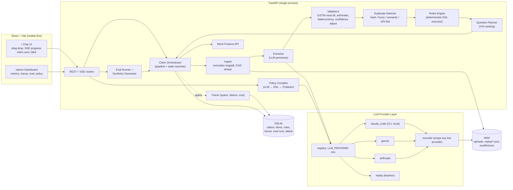
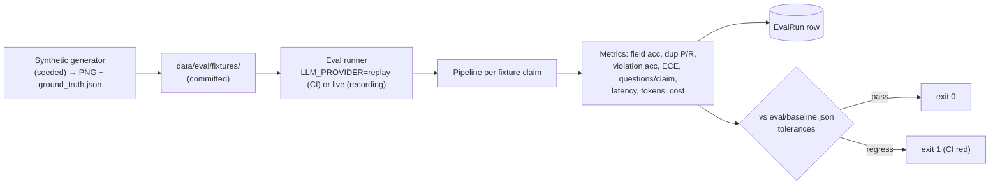
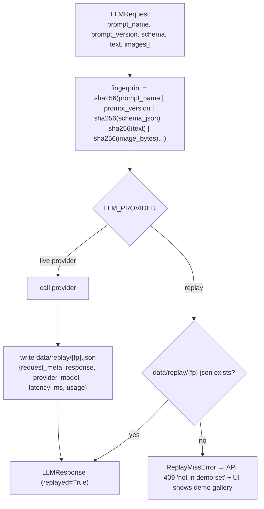
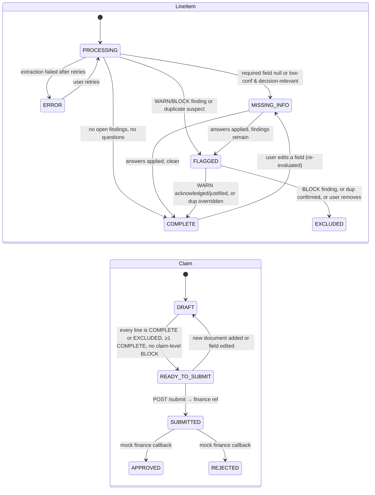

# ARCHITECTURE.md — Expense & Reimbursement Agent ("ClaimPilot")

Jio AI Innovation Lab Season 2, Round 2. Track: Enterprise Productivity / Agentic Document Understanding. One developer, ~22 build hours, deadline 12 Oct 2026.

---

## 1. Executive summary

Employees drop receipt photos, PDFs and UPI payment screenshots into a chat. The system turns that pile into a submission-ready reimbursement claim: it extracts every field with a confidence score and a source snippet, applies the company expense policy deterministically, catches duplicates three different ways, asks the user only the questions that would actually change the outcome, and submits to a (mocked) finance system with a full audit trail.

Design thesis, stated in one line and enforced everywhere: **the LLM perceives, the code decides.** Vision-language models read documents and propose structured facts; a deterministic rules engine, a GSTIN checksum validator, hash/fuzzy matchers and a state machine make every decision. Every flag carries the rule that fired and the policy sentence it came from. Every number on the admin dashboard is computed from stored traces, not estimated.

What is innovative (and what the judges will see):

| Differentiator | Why it matters |
|---|---|
| Policy-as-code compiled from plain English | Admin pastes a policy document; LLM compiles it once to a schema-validated JSON rule DSL with citations; the engine is deterministic and unit-testable. Change the policy, no code change. |
| Per-field confidence + provenance | Each field = `{value, confidence, source_snippet}`. UI highlights what the model was unsure of and where it read it. |
| Value-of-information question planner | Asks only about fields that are low-confidence **and** decision-relevant (outcome changes under counterfactual). Measured as questions-per-claim. |
| India-first | GST invoices, GSTIN mod-36 checksum, UPI screenshot ↔ invoice linking, Ola/Uber, fuel, hotel folios, handwritten bills, INR. |
| Three-layer duplicate detection | Perceptual hash → fuzzy (vendor, amount, date) → semantic n-gram embedding; UPI/invoice pairs are linked rather than double-counted. |
| Built-in evaluation | Synthetic receipt generator with ground truth; field accuracy, dup P/R, violation accuracy, ECE calibration, questions/claim, provider comparison; `make eval` regression gate in CI. |
| Built-in observability | OpenTelemetry-style spans per claim stored locally; cost/latency/error dashboards; "why flagged" audit trail. |
| Pluggable LLM providers with record/replay | Same pipeline runs on any provider; recorded responses give a keyless cloud demo and deterministic CI. |

### Business-impact model (shown on the dashboard, parameters editable in `config.py`)

Assumptions (synthetic, clearly labelled as such in UI): manual claim prep 12 min/claim employee time + 6 min finance review; with agent 2.5 min + 1.5 min; finance fully-loaded cost INR 600/hr; employee INR 900/hr.

- `time_saved_min = n_claims × ((12 + 6) − (2.5 + 1.5))` = 14 min/claim
- `auto_completion_rate = lines COMPLETE with zero questions / total lines`
- `first_pass_ready_rate = claims READY_TO_SUBMIT without any user answer / claims`
- `duplicate_leakage_prevented_inr = Σ amount of confirmed duplicate lines`
- `cost_per_claim_inr` = Σ span `cost_usd` × fx / claims (from traces, actual)
- Headline: for 1,000 claims/month → ~233 hours saved/month; LLM cost ≈ INR 2–4 per claim versus INR 210 of labour.

---

## 2. Architecture overview



Component responsibilities (one sentence each; module paths in section 11):

- **Ingest**: accepts image/PDF, EXIF-transposes, converts PDF pages to PNG (pypdfium2), downsizes to ≤1600px, computes SHA-256 and 64-bit dHash (4 rotations), persists to `data/uploads/`.
- **Extractor**: one vision call per document → `ExtractionResult` (doc type, fields with confidence + snippet, line items). Prompt is versioned; output is schema-constrained.
- **Validators**: deterministic checks that *adjust* confidence and *add* evidence: GSTIN checksum, items-sum vs total, tax arithmetic, date plausibility, currency normalisation.
- **Duplicate detector**: compares against all prior items of the same user (across claims, 90-day window).
- **Rules engine**: executes compiled `RuleSet` against claim; emits `Finding`s with citations. Pure functions, no I/O.
- **Question planner**: decides which fields to ask about, batched into one chat message; applies answers and re-runs validate→rules.
- **Orchestrator**: owns the state machine, writes spans, streams SSE events.
- **Policy compiler**: LLM converts policy text to DSL candidate; Pydantic validates; compiler verifies each citation quote exists verbatim in the policy text; stores `RuleSet` with version.
- **Eval runner**: generates/loads fixtures, runs pipeline in replay mode, computes metrics, writes `EvalRun`, compares to baseline.
- **Tracer**: context-manager spans with attributes, stored in SQLite; cost table per model.
- **Mock finance**: in-process "ERP" that accepts `SubmissionPayload`, returns `FIN-xxxx` reference, random-but-seeded approval after N seconds.

---

## 3. Key flows

### 3.1 Receipt upload → READY_TO_SUBMIT

```mermaid
sequenceDiagram
  autonumber
  participant U as User (Chat UI)
  participant API as FastAPI
  participant O as Orchestrator
  participant L as LLM Provider
  participant R as Rules Engine
  participant Q as Question Planner
  participant F as Mock Finance

  U->>API: POST /claims (create) ; POST /claims/{id}/documents (files)
  API-->>U: 202 + document ids ; UI opens GET /claims/{id}/events (SSE)
  API->>O: process_documents(claim_id, doc_ids)  [background task]
  loop each document (semaphore ≤3)
    O->>O: span ingest: normalize, sha256, dHash
    O-->>U: SSE {stage:"ingest", doc_id}
    O->>L: extract(image, prompt v, schema)
    L-->>O: ExtractionResult (fields+confidence+snippets)
    O-->>U: SSE {stage:"extract", preview fields}
    O->>O: span validate: GSTIN, arithmetic, confidence adjust
    O->>O: span dedupe: hash / fuzzy / semantic / UPI-link
  end
  O->>R: evaluate(claim, ruleset)
  R-->>O: Findings[] (rule_id, severity, citation)
  O->>Q: plan(claim, findings)
  Q-->>O: Questions[] (≤3, ranked by VOI)
  O->>O: set line statuses; claim status DRAFT
  O-->>U: SSE {stage:"done", claim summary, questions}
  U->>API: POST /claims/{id}/answers {field answers / confirm dup / justify flag}
  API->>O: apply_answers → validate → rules → plan (no LLM call)
  O-->>U: SSE updated claim ; if no open questions → READY_TO_SUBMIT
  U->>API: POST /claims/{id}/submit
  API->>F: submit(SubmissionPayload)
  F-->>API: {reference, status: SUBMITTED}
  API-->>U: claim SUBMITTED (+ audit trail link)
```

### 3.2 Policy compilation

```mermaid
sequenceDiagram
  participant A as Admin UI
  participant API as FastAPI
  participant C as Policy Compiler
  participant L as LLM Provider
  participant V as Pydantic RuleSet schema
  A->>API: POST /admin/policies {name, text}
  API->>C: compile(text)
  C->>L: complete(prompt=compile_policy v1, schema=RuleSet)
  L-->>C: JSON candidate
  C->>V: RuleSet.model_validate(candidate)
  alt validation error
    C->>L: repair prompt with error messages (max 2 retries)
  end
  C->>C: verify each citation.quote is a verbatim substring (normalised whitespace) of policy text; drop/flag unverifiable citations
  C->>C: dry-run engine on 3 built-in smoke claims (no crash, no contradiction e.g. cap<0)
  C-->>API: RuleSet v{n} saved (status ACTIVE), diff vs previous
  API-->>A: rules table with citations; "activate" toggle
```

### 3.3 Eval run



### 3.4 Record / replay



The fingerprint deliberately excludes provider and model so a response recorded locally is served identically on Render. Images are hashed by bytes; therefore eval fixture images are **committed, never regenerated in CI**.

---

## 4. Domain / data model

Storage: SQLite via SQLAlchemy 2.0 ORM, JSON columns for nested structures, `create_all` on startup (no Alembic). Pydantic v2 models are the source of truth for domain objects; ORM rows hold `id`, foreign keys, status/time columns for querying, and a `payload` JSON column for the nested Pydantic dump. This keeps the schema small and the domain rich.

```python
# domain/enums.py
class DocType(str, Enum): INVOICE="invoice"; RECEIPT="receipt"; UPI_SCREENSHOT="upi_screenshot"; HOTEL_FOLIO="hotel_folio"; RIDE_RECEIPT="ride_receipt"; FUEL="fuel"; HANDWRITTEN="handwritten"; UNKNOWN="unknown"
class Category(str, Enum): MEALS="meals"; TRAVEL_LOCAL="travel_local"; TRAVEL_INTERCITY="travel_intercity"; LODGING="lodging"; FUEL="fuel"; OFFICE="office"; INTERNET_PHONE="internet_phone"; OTHER="other"
class LineStatus(str, Enum): PROCESSING="processing"; MISSING_INFO="missing_info"; FLAGGED="flagged"; COMPLETE="complete"; EXCLUDED="excluded"; ERROR="error"
class ClaimStatus(str, Enum): DRAFT="draft"; READY_TO_SUBMIT="ready_to_submit"; SUBMITTED="submitted"; APPROVED="approved"; REJECTED="rejected"
class Severity(str, Enum): INFO="info"; WARN="warn"; BLOCK="block"
class FindingKind(str, Enum): POLICY="policy"; DUPLICATE="duplicate"; VALIDATION="validation"; MISSING="missing"
class PaymentMethod(str, Enum): UPI="upi"; CARD="card"; CASH="cash"; UNKNOWN="unknown"
```

```python
# domain/models.py (Pydantic v2)
class ExtractedField(BaseModel, Generic[T]):
    value: T | None
    confidence: float = Field(ge=0, le=1)
    source_snippet: str | None = None       # verbatim text the model read
    origin: Literal["llm","validator","user","assumed"] = "llm"
    history: list[FieldEdit] = []           # user corrections (online labels)

class ReceiptItem(BaseModel):
    description: str; quantity: float | None; unit_price: float | None; amount: float | None

class ExtractedReceipt(BaseModel):          # == LLM structured output schema (minus `history`)
    doc_type: ExtractedField[DocType]
    vendor_name: ExtractedField[str]
    vendor_gstin: ExtractedField[str]
    invoice_number: ExtractedField[str]
    date: ExtractedField[date]
    currency: ExtractedField[str]           # ISO, default INR
    subtotal: ExtractedField[float]
    tax_amount: ExtractedField[float]
    total_amount: ExtractedField[float]
    payment_method: ExtractedField[PaymentMethod]
    upi_txn_id: ExtractedField[str]         # UTR / reference, for UPI screenshots or UPI-paid receipts
    payee_name: ExtractedField[str]         # UPI screenshots
    city: ExtractedField[str]
    category: ExtractedField[Category]      # proposed
    attendees_count: ExtractedField[int]    # meals
    items: list[ReceiptItem] = []
    raw_text: str                           # model transcription, used for semantic dedupe
    quality: Literal["good","blurry","partial","rotated","handwritten"]

class Document(BaseModel):
    id: str; claim_id: str; filename: str; mime: str; sha256: str; dhash: str
    dhash_rotations: list[str]; width: int; height: int; page: int = 0; stored_path: str

class Finding(BaseModel):
    id: str; kind: FindingKind; severity: Severity; rule_id: str | None
    message: str; citation: Citation | None
    evidence: dict                          # e.g. {"matched_line_id":..., "score":0.93, "layer":"fuzzy"}
    resolution: Literal["open","acknowledged","justified","overridden","confirmed"] = "open"
    justification: str | None = None

class LineItem(BaseModel):
    id: str; claim_id: str; document_ids: list[str]   # invoice + linked UPI proof
    extracted: ExtractedReceipt
    category: Category; amount_inr: float; reimbursable_inr: float
    status: LineStatus; findings: list[Finding]
    linked_proof_line_id: str | None       # UPI screenshot merged into this line
    trip_key: str | None                    # "2026-10-03:Mumbai" (nice-to-have clustering)
    questions_asked: int = 0

class Question(BaseModel):
    id: str; line_id: str; field: str; prompt: str
    kind: Literal["value","choice","confirm_duplicate","justify_flag"]
    choices: list[str] | None; voi_score: float; reason: str   # "would change reimbursable amount"

class Claim(BaseModel):
    id: str; user_id: str; title: str; status: ClaimStatus
    lines: list[LineItem]; open_questions: list[Question]
    total_inr: float; reimbursable_inr: float
    ruleset_version: int; finance_reference: str | None
    created_at: datetime; updated_at: datetime; submitted_at: datetime | None
```

Rule DSL (section 6), Trace/Span and Eval models:

```python
class Span(BaseModel):
    id: str; trace_id: str; parent_id: str | None; name: str   # ingest|extract|validate|dedupe|rules|plan|submit|compile
    start: datetime; end: datetime; status: Literal["ok","error","retry"]
    attributes: dict  # provider, model, prompt_name, prompt_version, tokens_in, tokens_out, cost_usd, replayed, error, attempt
class Trace(BaseModel): id: str; claim_id: str; kind: Literal["claim","policy","eval"]; spans: list[Span]

class EvalRun(BaseModel):
    id: str; created_at: datetime; provider: str; model: str; prompt_version: str
    n_receipts: int; metrics: EvalMetrics; per_field: dict[str, FieldMetric]
    reliability_bins: list[ReliabilityBin]; passed_gate: bool; git_sha: str | None
class EvalMetrics(BaseModel):
    field_accuracy: float; amount_exact_rate: float; date_exact_rate: float; gstin_exact_rate: float
    dup_precision: float; dup_recall: float; violation_accuracy: float; ece: float
    questions_per_claim: float; auto_completion_rate: float
    p50_latency_ms: float; p95_latency_ms: float; mean_tokens: float; cost_usd_per_receipt: float

class CorrectionLabel(BaseModel):  # online eval
    id: str; line_id: str; field: str; predicted: Any; confidence: float; corrected: Any; created_at: datetime
```

ORM tables: `claims`, `line_items`, `documents`, `rulesets`, `policies`, `traces`, `spans`, `eval_runs`, `correction_labels`, `submissions`. Indices: `line_items(user_id, date)`, `documents(dhash)`, `spans(trace_id)`.

---

## 5. State machine



Transition rules live in `domain/state.py` as a pure function `derive_line_status(line) -> LineStatus` and `derive_claim_status(claim) -> ClaimStatus`, recomputed after every change (no stored transition table to drift). Illegal API actions (submit on DRAFT) return 409. A UPI screenshot line that gets linked to an invoice becomes `EXCLUDED` with `evidence.linked_to` and the invoice line gains `proof_of_payment=True`.

---

## 6. Rule DSL

Design goals: small enough to execute in 150 lines, expressive enough for a realistic Indian corporate policy, every rule traceable to policy text.

```python
class Citation(BaseModel):
    section: str                  # "4.2 Meals"
    quote: str                    # verbatim sentence from the policy
    char_start: int; char_end: int   # located by compiler, verified

Field = Literal["amount_inr","category","date","vendor_gstin","vendor_gstin_valid","payment_method",
                "has_proof_of_payment","attendees_count","city","doc_type","days_since_expense",
                "invoice_number","is_weekend","per_person_amount","distance_km"]
Op = Literal["eq","ne","gt","gte","lt","lte","in","not_in","is_null","not_null","regex"]

class Cond(BaseModel):
    field: Field | None = None; op: Op | None = None; value: Any = None
    all: list["Cond"] | None = None; any: list["Cond"] | None = None; not_: "Cond" | None = Field(None, alias="not")

class Action(BaseModel):
    type: Literal["flag","block","cap","require_field","require_justification","set_category"]
    field: Field | None = None           # for require_field
    cap_inr: float | None = None         # for cap
    cap_basis: Literal["line","per_person","per_day_category","per_claim_category"] | None = None

class Rule(BaseModel):
    id: str                               # "MEALS_CAP_PER_PERSON"
    title: str; category: Category | Literal["any"]
    scope: Literal["line","day_category","claim"]
    when: Cond                            # applies-if
    action: Action
    severity: Severity
    message_template: str                 # "Meal of ₹{amount_inr} exceeds ₹{cap_inr} per person"
    citation: Citation
    confidence: float                     # compiler's confidence the rule reflects the text (shown to admin)

class RuleSet(BaseModel):
    version: int; policy_id: str; policy_sha256: str; compiled_at: datetime
    compiler_prompt_version: str; provider: str; model: str
    required_fields: dict[Category | Literal["any"], list[Field]]   # drives MISSING_INFO
    rules: list[Rule]
    defaults: dict = {}                    # {"currency":"INR","submission_window_days":30}
```

Engine semantics (`rules/engine.py`, pure): derived fields are computed first (`vendor_gstin_valid` via checksum, `per_person_amount`, `days_since_expense`, `is_weekend`); `line` rules run per line; `day_category` rules aggregate `amount_inr` grouped by `(date, category)` across the claim and prior submitted claims of the user in the same day; `claim` rules see totals. `cap` produces `reimbursable_inr = min(amount, cap)` plus a WARN finding; `block` produces BLOCK; `require_field` adds a MISSING finding if null. Findings are deterministic given the same claim and ruleset — this is unit-tested with golden files.

Sample compiled rules from the shipped fictional policy (`data/policies/jio_travel_expense_policy.md`):

```json
{"id":"MEALS_CAP_PER_PERSON","category":"meals","scope":"line",
 "when":{"all":[{"field":"category","op":"eq","value":"meals"},{"field":"per_person_amount","op":"gt","value":750}]},
 "action":{"type":"cap","cap_inr":750,"cap_basis":"per_person"},"severity":"warn",
 "message_template":"Meal works out to ₹{per_person_amount}/person, above the ₹750 limit; reimbursed at cap.",
 "citation":{"section":"4.2 Meals","quote":"Meals are reimbursed up to INR 750 per person per meal.","char_start":1842,"char_end":1898},"confidence":0.96}

{"id":"GST_INVOICE_ABOVE_5000","category":"any","scope":"line",
 "when":{"all":[{"field":"amount_inr","op":"gte","value":5000},{"field":"vendor_gstin_valid","op":"ne","value":true}]},
 "action":{"type":"require_field","field":"vendor_gstin"},"severity":"block",
 "message_template":"Expenses of ₹5,000 or more need a valid GST invoice (GSTIN missing or fails checksum).",
 "citation":{"section":"3.1 Documentation","quote":"Any single expense of INR 5,000 or more must be supported by a GST tax invoice bearing the vendor's GSTIN.","char_start":902,"char_end":1010},"confidence":0.98}

{"id":"SUBMISSION_WINDOW_30D","category":"any","scope":"line",
 "when":{"field":"days_since_expense","op":"gt","value":30},
 "action":{"type":"require_justification"},"severity":"warn",
 "message_template":"Expense is {days_since_expense} days old; policy window is 30 days. Add a justification.",
 "citation":{"section":"2.3 Timelines","quote":"Claims must be submitted within 30 days of the expense date.","char_start":610,"char_end":672},"confidence":0.99}

{"id":"UPI_PROOF_FOR_CASHLESS","category":"any","scope":"line",
 "when":{"all":[{"field":"payment_method","op":"eq","value":"upi"},{"field":"has_proof_of_payment","op":"eq","value":false},{"field":"amount_inr","op":"gt","value":2000}]},
 "action":{"type":"flag"},"severity":"warn",
 "message_template":"UPI payment above ₹2,000 without a matching payment confirmation screenshot.",
 "citation":{"section":"3.2 Proof of payment","quote":"For digital payments above INR 2,000, attach the payment confirmation.","char_start":1120,"char_end":1189},"confidence":0.9}

{"id":"LODGING_CAP_METRO","category":"lodging","scope":"line",
 "when":{"all":[{"field":"city","op":"in","value":["Mumbai","Delhi","Bengaluru","Hyderabad","Chennai","Kolkata","Pune"]},{"field":"amount_inr","op":"gt","value":6000}]},
 "action":{"type":"cap","cap_inr":6000,"cap_basis":"line"},"severity":"warn",
 "message_template":"Hotel in {city} above the metro cap of ₹6,000/night.",
 "citation":{"section":"5.1 Lodging","quote":"Hotel stays are capped at INR 6,000 per night in metro cities and INR 4,000 elsewhere.","char_start":2210,"char_end":2300},"confidence":0.95}
```

Citation mechanics: the compiler prompt requires `quote` to be copied verbatim. `citations.py` locates the quote in the normalised policy text (`\s+`→space, case-preserved) to fill `char_start/end`; if not found it tries fuzzy (rapidfuzz `partial_ratio ≥ 92`) and marks `citation_verified=False`, which the admin UI shows in amber. The chat UI renders "Why?" on any finding as rule title + quoted sentence + section. The policy page highlights the spans that produced rules, and lists policy sentences with no rule (coverage view) — a cheap but striking visual.

---

## 7. Question planner (value-of-information ranking)

Inputs: the claim after validate + dedupe + rules. Output: ≤3 questions per round, merged into one chat message, each with a plain reason.

```
for each line L in claim:
  candidates = []
  # A. hard-missing required fields → always ask (VOI = 1.0)
  for f in ruleset.required_fields[L.category] ∪ required_fields["any"]:
      if L.extracted[f].value is None: candidates += Question(f, kind="value", voi=1.0, reason="required by policy")
  # B. low-confidence fields → ask only if decision-relevant
  for f in fields with confidence < TAU (0.75) and value not None:
      alts = counterfactuals(f, L)          # e.g. amount: ±digit transposition, ×10; date: swap d/m, ±1 month; category: top-2 other categories; gstin: None; payment_method: other
      outcomes = { outcome(evaluate(L with f=alt)) for alt in alts } ∪ { outcome(L) }
      if len(outcomes) > 1:                 # the decision would change
          impact = max |Δ reimbursable_inr| over alts, normalised by L.amount_inr, plus 1.0 if status class changes (COMPLETE↔FLAGGED/EXCLUDED)
          voi = (1 - confidence) * (0.5 + 0.5*min(impact, 1))
          candidates += Question(f, kind="value"|"choice", voi, reason=explain(outcomes))
      else: mark field origin="assumed" (shown as grey "assumed" chip; no question)
  # C. finding-driven questions
  for finding in L.findings where resolution == "open":
      DUPLICATE  → Question(kind="confirm_duplicate", voi = 0.9 * finding.evidence.score)
      WARN with require_justification or cap → Question(kind="justify_flag", voi = 0.6)
      BLOCK → no question (user must fix or exclude; the card shows the fix path)
rank all candidates by voi desc, tie-break by amount desc; dedupe same (line, field)
ask top MAX_QUESTIONS_PER_ROUND (3); remaining stay queued for next round
```

`outcome(L)` = `(derived status, round(reimbursable_inr), frozenset(rule ids fired))`. Because `evaluate` is pure and fast (<1 ms), counterfactual simulation is cheap: ~15 fields × ~4 alternates per line. Answers set `origin="user"`, `confidence=1.0`, append a `CorrectionLabel` if the value changed (online eval), and trigger re-evaluation with no LLM call. Questions-per-claim and "assumed" counts are stored on the claim for the dashboard.

---

## 8. Duplicate detection

Candidate pool: all `LineItem`s of the same `user_id` whose date is within ±90 days of the new line (across all claims, excluding EXCLUDED lines), plus the other lines of the current claim. Run layers in order; the first that fires sets the finding, later layers still run to enrich evidence.

| Layer | Signal | Threshold | Severity |
|---|---|---|---|
| 1. Perceptual | SHA-256 equal, or Hamming distance of 64-bit dHash (min over 4 rotations) | sha256 equal → score 1.0; Hamming ≤ 6 → score 0.97 | BLOCK (same file) / WARN |
| 2. Fuzzy | `vendor_sim = rapidfuzz.token_set_ratio(norm(vendor_a), norm(vendor_b))/100`; `amount_match = |a−b| ≤ max(1, 0.5% of a)`; `date_delta_days`; `invoice_number` equal after normalisation | invoice_number equal and amount_match → 0.98; else `score = 0.5*vendor_sim + 0.35*amount_match + 0.15*max(0, 1 − date_delta/3)`; fire if score ≥ 0.80 | WARN |
| 3. Semantic | cosine similarity of hashed character 3–5-gram TF vectors (4096 dims, pure Python/numpy) over `raw_text + items`; catches re-photographed or re-printed bills with different crop/quality | cos ≥ 0.85 and amount_match → 0.9; cos ≥ 0.92 alone → 0.85 | WARN |
| UPI link (not a duplicate) | new or existing line is `upi_screenshot`; amount exact (±1 INR); date within ±1 day; `payee_name ~ vendor_name` token_set_ratio ≥ 70 **or** `upi_txn_id` appears in the invoice text | link; UPI line → EXCLUDED with `linked_to`; invoice gets `has_proof_of_payment=True` | INFO |

Explicit non-duplicates: two Ola/Uber rides on the same day with different amounts (fuzzy score stays < 0.8 because amount_match=0); handled by tests. The `Embedder` is an interface (`embed(text) -> np.ndarray`); the default is the hashed n-gram embedder (deterministic, offline). A provider-backed embedder is CUT unless time remains. Trip clustering (`trip_key = date:city`, lodging spans dates) is a label for the UI only — SHOULD, 30 min.

Eval ground truth marks planted duplicates (same file re-uploaded, re-photographed, same bill different crop, and near-miss decoys) so dup precision/recall are real numbers.

---

## 9. LLM provider layer

```python
# llm/base.py
class LLMRequest(BaseModel):
    prompt_name: str; prompt_version: str; system: str; user_text: str
    images: list[ImageInput]            # bytes + mime + local path (for claude_code)
    schema: dict                        # JSON schema from Pydantic model_json_schema()
    max_tokens: int = 2048; temperature: float = 0.0
    def fingerprint(self) -> str: ...   # section 3.4

class Usage(BaseModel): input_tokens: int | None; output_tokens: int | None; cost_usd: float | None
class LLMResponse(BaseModel):
    data: dict; raw_text: str; provider: str; model: str; latency_ms: int; usage: Usage; replayed: bool = False; attempt: int = 1

class LLMProvider(Protocol):
    name: str; model: str; supports_vision: bool
    async def complete_structured(self, req: LLMRequest) -> LLMResponse: ...

class LLMClient:                        # the only thing the pipeline sees
    def __init__(self, provider: LLMProvider, recorder: Recorder | None, limiter: asyncio.Semaphore, tracer: Tracer)
    async def extract(self, images, prompt_version=None) -> tuple[ExtractedReceipt, LLMResponse]
    async def compile_policy(self, text) -> tuple[RuleSet, LLMResponse]
    async def _call(self, req, model_cls) -> tuple[BaseModel, LLMResponse]   # retries + validation + span
```

Providers:

- `claude_code.py`: `asyncio.create_subprocess_exec("claude","-p",prompt,"--tools","Read","--allowedTools","Read","--output-format","json","--json-schema",schema_json,"--model",settings.CLAUDE_CODE_MODEL (default "sonnet"))`, `cwd=data/uploads`, timeout 120 s, prompt says "Read the image at `<absolute path>` then…". Parse stdout JSON → `structured_output`; also read `usage`/`total_cost_usd`/`duration_ms` if present. Concurrency: process-wide semaphore `LLM_MAX_CONCURRENCY=3`. Local only; the Dockerfile does not include it.
- `gemini.py`: REST `generateContent` with `inlineData` images and `responseMimeType: application/json` + `responseSchema`; httpx, API key from env.
- `anthropic.py`: Messages API, image content blocks, structured output via a single forced tool `emit_result` whose `input_schema` is the request schema; httpx.
- `replay.py`: filesystem lookup; raises `ReplayMissError`.
- `Recorder`: wraps any live provider; writes `data/replay/{fp}.json` when `LLM_RECORD=1` (default on for live providers in dev). Replay files store `request_meta` (prompt name/version, image sha256s, byte sizes), never the images themselves.
- `ollama.py`: CUT (text-only; receipts need vision). Mentioned in docs as a possible text-only compiler backend only if 20 min remain.

Prompt versioning: prompts live in `llm/prompts/{name}/v{N}.md` with YAML front matter (`version`, `schema_model`, `notes`). `PromptRegistry.get(name, version=None)` returns latest unless pinned via env `PROMPT_VERSION_EXTRACT=v1`. Version is recorded in spans, in replay fingerprints, and in eval runs, so a prompt change is a visible, measurable event on the dashboard.

Structured output strategy: Pydantic model → JSON schema → provider-native constraint (Claude CLI `--json-schema`, Gemini `responseSchema`, Anthropic forced tool). On `ValidationError`: one repair retry with the error text appended (`attempt=2`), then a final attempt with a smaller "core fields" schema; if still failing the line goes to `ERROR` with the raw text kept for debugging. Transport errors: exponential backoff 1 s/3 s, max 3 attempts; 429 honours `Retry-After`. Every attempt is a span with `status="retry"`.

Cost table (`observability/cost.py`): per-model USD per 1M tokens; `claude_code` uses the CLI-reported `total_cost_usd` when present, otherwise the sonnet table; replay copies recorded usage and marks `replayed=True` so the dashboard can show "recorded cost" versus live.

---

## 10. API

Base `/api`. Auth: none (single demo user `demo-user`; `X-User-Id` header honoured for multi-user demos). Admin routes are under `/api/admin` and gated by `ADMIN_TOKEN` env if set.

| Method | Path | Purpose |
|---|---|---|
| POST | `/claims` | create claim `{title?}` → Claim |
| GET | `/claims` | list for user |
| GET | `/claims/{id}` | full claim (lines, findings, questions) |
| POST | `/claims/{id}/documents` | multipart files (image/pdf, max 10/request, 10 MB each) → 202 `{document_ids}`; starts background processing |
| GET | `/claims/{id}/events` | SSE stream: `stage`, `line_update`, `question`, `claim_update`, `error`, `done` |
| POST | `/claims/{id}/answers` | `[{question_id, value}]` or `[{line_id, field, value}]`; returns updated claim |
| POST | `/claims/{id}/lines/{line_id}/actions` | `{action: exclude|restore|override_duplicate|confirm_duplicate|justify, justification?}` |
| PATCH | `/claims/{id}/lines/{line_id}` | direct field edit (logged as correction label) |
| POST | `/claims/{id}/submit` | 409 unless READY_TO_SUBMIT → `{finance_reference}` |
| GET | `/claims/{id}/audit` | findings with rule + citation + source snippets, span timeline |
| GET | `/demo/receipts` | demo gallery (pre-recorded synthetic receipts) ; POST `/claims/{id}/documents/from-demo {names[]}` |
| GET | `/policies/active` | active ruleset (chat "Why?" and policy page) |
| POST | `/admin/policies` | `{name, text}` → compile → RuleSet (SSE not needed; ~15 s) |
| GET | `/admin/policies`, `/admin/rulesets/{v}` | list / detail ; POST `/admin/rulesets/{v}/activate` |
| GET | `/admin/metrics/overview?days=30` | claims/day, cost/claim, p50/p95, error/retry rate, violations by rule, dup catches by layer, questions/claim, auto-completion, time saved |
| GET | `/admin/traces?claim_id=` and `/admin/traces/{id}` | span tree |
| POST | `/admin/eval/run` | `{subset?: "smoke"|"full"}` → runs in background; SSE `/admin/eval/events` |
| GET | `/admin/eval/runs`, `/admin/eval/runs/{id}` | history, metrics, reliability diagram data, per-field table, provider comparison |
| GET | `/admin/labels` | online correction labels |
| GET | `/health`, `/version` | provider name, model, prompt versions, git sha, replay mode flag |
| POST | `/finance/submissions` (mock) | internal; also GET `/finance/submissions/{ref}` |

---

## 11. Repository structure

```
office_ai_innovation/
├── README.md                      # quickstart, screenshots, architecture summary, links
├── LICENSE (MIT)
├── Makefile                       # dev, test, eval, lint, build, docker, record-demo, synth
├── pyproject.toml                 # uv project; [project.optional-dependencies] dev
├── uv.lock
├── .python-version                # 3.12
├── .env.example
├── .gitignore                     # data/uploads/, .env, node_modules, dist, .venv
├── Dockerfile                     # multi-stage: node build → python runtime serving /frontend/dist
├── render.yaml                    # LLM_PROVIDER=replay
├── .github/workflows/ci.yml       # lint, pytest+cov, frontend build+vitest, make eval (replay)
├── docs/
│   ├── ARCHITECTURE.md            # this document
│   ├── TECHNICAL_DESIGN.md        # competition deliverable (overview, diagrams, setup, code walkthrough, assumptions)
│   ├── EVALUATION.md              # metric definitions + latest results table
│   ├── DEMO_SCRIPT.md
│   └── img/                       # screenshots, exported diagrams
├── backend/
│   ├── app/
│   │   ├── main.py                # FastAPI app, routers, static mount, lifespan (db init, provider)
│   │   ├── config.py              # pydantic-settings: LLM_PROVIDER, keys, thresholds, impact params
│   │   ├── db.py                  # engine, session, ORM tables, create_all
│   │   ├── api/
│   │   │   ├── claims.py  documents.py  events.py  policies.py  admin.py  demo.py  finance.py  health.py
│   │   │   └── sse.py             # per-claim asyncio.Queue broker
│   │   ├── domain/
│   │   │   ├── enums.py  models.py  state.py  repo.py   # repo = ORM <-> Pydantic mapping
│   │   ├── llm/
│   │   │   ├── base.py  client.py  registry.py  recorder.py  fingerprint.py
│   │   │   ├── providers/ claude_code.py  gemini.py  anthropic.py  replay.py
│   │   │   └── prompts/ extract_receipt/v1.md  compile_policy/v1.md  registry.py
│   │   ├── pipeline/
│   │   │   ├── ingest.py          # normalize, pdf→png, exif, sha256, dhash
│   │   │   ├── extract.py         # LLMClient.extract + post-processing (currency, dates)
│   │   │   ├── validate/ gstin.py  arithmetic.py  dates.py  confidence.py
│   │   │   ├── dedupe/ phash.py  fuzzy.py  semantic.py  upi_link.py  detector.py
│   │   │   ├── planner.py         # question planner
│   │   │   └── orchestrator.py    # process_documents, apply_answers, submit
│   │   ├── rules/
│   │   │   ├── dsl.py  engine.py  derived.py  compiler.py  citations.py
│   │   ├── observability/
│   │   │   ├── tracing.py  cost.py  metrics.py  impact.py
│   │   ├── evaluation/
│   │   │   ├── synth/ generator.py  templates.py  augment.py  fonts/  policy_scenarios.py
│   │   │   ├── runner.py  metrics.py  calibration.py  gate.py  compare.py
│   │   └── finance_mock.py
│   └── tests/
│       ├── conftest.py            # tmp sqlite, FakeProvider, fixture loader, client
│       ├── unit/  test_gstin.py test_arithmetic.py test_confidence.py test_dsl.py test_engine.py test_derived.py
│       │          test_citations.py test_compiler.py test_phash.py test_fuzzy.py test_semantic.py test_upi_link.py
│       │          test_detector.py test_planner.py test_state.py test_fingerprint.py test_recorder_replay.py
│       │          test_provider_gemini.py test_provider_anthropic.py test_provider_claude_code.py
│       │          test_tracing.py test_cost.py test_metrics.py test_calibration.py test_generator.py test_gate.py
│       ├── integration/ test_api_claims.py test_api_sse.py test_api_admin.py test_pipeline_e2e_replay.py
│       └── golden/ rules_findings/*.json  extraction/*.json
├── frontend/
│   ├── package.json  vite.config.ts  tailwind.config.ts  tsconfig.json  index.html
│   └── src/
│       ├── main.tsx  App.tsx  api/client.ts  api/sse.ts  types.ts
│       ├── pages/ ChatPage.tsx  AdminPage.tsx
│       ├── components/chat/ DropZone.tsx  MessageList.tsx  ProgressBubble.tsx  ClaimCard.tsx  LineItemCard.tsx
│       │                    FieldChip.tsx (confidence colour + snippet popover)  QuestionForm.tsx  WhyDrawer.tsx  DemoGallery.tsx
│       ├── components/admin/ Overview.tsx  KpiTile.tsx  TraceViewer.tsx  EvalPanel.tsx  ReliabilityChart.tsx  PolicyEditor.tsx  RuleTable.tsx  AuditTrail.tsx
│       └── __tests__/ (vitest: ClaimCard, FieldChip, QuestionForm, sse parser)
└── data/
    ├── policies/jio_travel_expense_policy.md
    ├── rulesets/jio_v1.json          # committed compiled ruleset (so replay/CI never needs compile)
    ├── demo_receipts/                 # ~12 curated synthetic receipts used in the video and cloud gallery
    ├── eval/fixtures/{id}.png + ground_truth.jsonl + manifest.json   # ~60, committed
    ├── eval/baseline.json             # gate thresholds
    ├── replay/*.json                  # recorded LLM responses (committed, synthetic content only)
    └── uploads/ (gitignored)
```

---

## 12. Testing strategy

Target: backend ≥ 85% line coverage (enforced `--cov-fail-under=80` in CI, aim higher), all pure modules ≥ 95%. Frontend: vitest on 4 components (coverage not gated). Every test runs offline: no network, no CLI, `LLM_PROVIDER=replay` or `FakeProvider`.

Unit inventory (what each proves):

- `test_gstin.py`: valid checksums (10 known-good synthetic GSTINs), single-char corruption fails, state code range, PAN pattern, lowercase/space normalisation.
- `test_arithmetic.py`: subtotal+tax=total within tolerance, GST 5/12/18% split detection, items-sum mismatch lowers `total_amount` confidence, rounding.
- `test_confidence.py`: adjustment rules (checksum fail → gstin conf 0.0; reconciled total → +0.15 capped at 0.99; `quality=blurry` → −0.1 all).
- `test_dsl.py`: schema accepts valid rules, rejects unknown field/op, nested all/any/not evaluation table.
- `test_engine.py` + golden: per rule positive/negative claim; cap sets `reimbursable_inr`; day_category aggregation across claims; block → EXCLUDED; determinism (same input twice → identical findings JSON).
- `test_derived.py`: per_person, days_since_expense, is_weekend, gstin_valid.
- `test_citations.py`: verbatim locate, whitespace-normalised locate, fuzzy fallback flagged unverified.
- `test_compiler.py`: FakeProvider returns (a) valid DSL, (b) invalid then valid (repair path), (c) invalid thrice → `CompileError`; policy sha stored.
- `test_phash.py`: identical → 0; rotated 90° → ≤ 6 via rotations; different receipts > 20; blur ≤ 6.
- `test_fuzzy.py`: same vendor/amount/date → ≥ 0.8; two rides same day different amounts → < 0.8; "Starbucks Coffee Pvt Ltd" vs "STARBUCKS" high; invoice-number equality shortcut.
- `test_semantic.py`: embedder deterministic; same text cos 1.0; perturbed text ≥ 0.85; unrelated < 0.5.
- `test_upi_link.py`: exact amount ±1, ±1 day, payee match → link; amount mismatch → no link; txn id in invoice text → link even with poor payee.
- `test_detector.py`: layer ordering, evidence contents, candidate window, excluded lines ignored.
- `test_planner.py`: required-null → asked; low-conf non-relevant → assumed (no question); low-conf relevant → asked with reason; max 3 per round; ranking order; answer application changes status; correction label written.
- `test_state.py`: every transition in section 5 + 409 cases.
- `test_fingerprint.py`: stable across provider/model; changes on prompt version, schema, image bytes.
- `test_recorder_replay.py`: record then replay returns identical data; miss raises.
- `test_provider_*.py`: respx-mocked httpx for gemini/anthropic (success, 429 retry, validation repair, malformed JSON); claude_code with monkeypatched `create_subprocess_exec` returning canned stdout, timeout path, nonzero exit.
- `test_tracing.py`/`test_cost.py`/`test_metrics.py`: span nesting, error status, cost per model, p50/p95, rates with empty data.
- `test_calibration.py`: ECE on hand-computed bins; perfectly calibrated → 0.
- `test_generator.py`: seeded generator reproducible; ground truth matches rendered values; augmentations keep size; planted duplicates tagged.
- `test_gate.py`: regress beyond tolerance fails; within passes; missing baseline → warn.
- Integration: create claim → upload fixture → SSE events in order → questions → answers → ready → submit; admin metrics endpoint shapes; eval run on 6-fixture "smoke" subset in replay mode.

Fixtures: `conftest.py` builds claims via a `make_line(**overrides)` factory; `FakeProvider(responses=[...])` returns scripted dicts; `golden/` JSON compared with `DeepDiff`-free plain equality after sorting.

Eval regression gate: `make eval` = `uv run python -m app.evaluation.runner --subset full --provider replay --gate`. Compares to `data/eval/baseline.json` (`field_accuracy ≥ baseline − 0.02`, `dup_recall ≥ − 0.05`, `violation_accuracy ≥ − 0.02`, `ece ≤ + 0.03`, `questions_per_claim ≤ + 0.5`). Updating the baseline is an explicit `make eval-baseline` commit.

CI (`.github/workflows/ci.yml`): two jobs. `backend`: `uv sync`, `ruff check`, `ruff format --check`, `pytest --cov`, `make eval` (replay; ~1 min, no keys). `frontend`: `npm ci`, `tsc --noEmit`, `vitest run`, `vite build`. Coverage badge via pytest-cov summary in job output (no external service).

---

## 13. Evaluation and observability (admin)

Synthetic generator (`evaluation/synth`): Pillow renders templates — restaurant GST bill, Ola/Uber ride receipt, fuel pump slip, hotel folio (multi-night), stationery invoice, UPI success screenshot (GPay/PhonePe/Paytm style, synthetic names), handwritten-style bill (handwriting font + jitter). Variables drawn from seeded faker-like lists (fictional vendors, GSTINs generated with valid checksums, Indian cities). Augmentations: gaussian blur σ∈[0.8,1.6], rotation ±3–12°, perspective warp, crumple-like noise + shadow gradient, JPEG q=40. Scenario planting: 8 exact duplicates, 6 re-photographed duplicates, 4 near-miss decoys, 10 policy violations across 4 rules, 8 UPI pairs, 5 missing-field receipts (no date/no GSTIN). Ground truth JSONL: all fields, expected findings (rule ids), duplicate group ids, expected UPI links. ~60 receipts in ~12 claims.

Metric definitions (`evaluation/metrics.py`):

- Field accuracy: per field, exact match after normalisation (amount ±0.5, date exact, strings casefolded/whitespace-collapsed; GSTIN exact). Macro over fields and micro over all cells.
- Duplicate precision/recall: pairs flagged vs ground-truth duplicate pairs (same group id), decoys count toward false positives.
- Policy-violation accuracy: per line, set-equality of fired BLOCK/WARN rule ids vs expected (also per-rule precision/recall).
- Confidence calibration: ECE over 10 equal-width bins on field-level (confidence, correct) pairs; reliability diagram data; Brier score.
- Questions per claim; auto-completion rate; p50/p95 extract latency; mean tokens; cost per receipt.
- Provider comparison: one `EvalRun` per `(provider, model, prompt_version)`; the comparison table joins the latest run per key. The locally recorded run is simply one row; docs describe the mechanism, not which vendor produced the demo.

Observability storage: `traces`/`spans` tables; a `Tracer` context manager (`with tracer.span("extract", claim_id=..., **attrs)`) that records duration, status, exception text; `LLMClient` adds provider/model/prompt/tokens/cost. Retention: unlimited (SQLite, demo scale). Optional Langfuse export: a 40-line `export_langfuse.py` behind `LANGFUSE_*` env — CUT-IF-LATE.

Admin screens (one page, tabbed):

1. **Overview**: KPI tiles (claims today/30d, auto-completion %, questions/claim, cost/claim INR, p50/p95 extract latency, error+retry %, time saved h, duplicate INR prevented); charts: claims per day (bar), cost per claim trend (line), latency distribution, violations by rule (horizontal bar), duplicate catches by layer (stacked), eval trend (field accuracy + ECE by run).
2. **Traces**: claim list → span waterfall with attributes; click an LLM span to see prompt version, tokens, replayed flag, raw response (truncated).
3. **Audit trail**: searchable findings table: claim, line, rule, severity, policy quote, source snippet, resolution, justification.
4. **Evaluation**: run button (smoke/full), live progress via SSE, latest metrics, per-field accuracy table, reliability diagram, provider comparison table, gate status, online labels count and top corrected fields.
5. **Policy**: textarea with the active policy, Compile button, rule table with citations and confidence, highlighted coverage view, version switcher, activate.

---

## 14. Security and compliance

- All receipts, vendors, names, GSTINs and UPI ids are synthetic; the generator never uses real brand names (fictional: "Chai Point Café" → "Chaiwala Corner Pvt Ltd", ride app "RydeGo", UPI app "PayNow"). README states this plus "no Jio/Reliance data".
- No keys in repo: `.env.example` lists `LLM_PROVIDER`, `GEMINI_API_KEY`, `ANTHROPIC_API_KEY`, `CLAUDE_CODE_MODEL`, `LLM_MAX_CONCURRENCY`, `LLM_RECORD`, `ADMIN_TOKEN`, `DATABASE_URL`, `DATA_DIR`. `.gitignore` covers `.env`, `data/uploads/`. Pre-commit-style `make lint` includes a grep for `sk-ant-|AIza` patterns.
- Replay files contain model outputs about synthetic receipts only; recorder strips any `api_key`-like strings from metadata (defensive).
- Uploads: MIME + magic-byte check, size cap, filename replaced by uuid, PDF rendered to raster (no PDF JS execution), images re-encoded via Pillow (strips EXIF/GPS).
- Prompt-injection stance: receipts are untrusted input; the LLM output is only data passed through schema validation; no tool calls other than Read on the pipeline path; the rules engine never consumes free text as instructions.
- Admin endpoints optional bearer token; CORS limited to same origin in production.
- Audit trail is append-only in spirit: field edits produce `history` entries and `CorrectionLabel`s; findings record resolution and justification with timestamps.

---

## 15. Deployment

Local (`make dev`): installs uv if missing (`curl -LsSf https://astral.sh/uv/install.sh | sh`), `uv sync`, `npm --prefix frontend install`, then runs `uvicorn app.main:app --reload --port 8000` and `vite --port 5173` concurrently (Vite proxies `/api` to 8000). `.env` defaults to `LLM_PROVIDER=claude_code` with `LLM_RECORD=1` on this machine. Other Make targets: `test`, `eval`, `eval-baseline`, `synth` (regenerate fixtures, explicit only), `record-demo` (runs demo gallery + eval fixtures through the live provider to populate `data/replay`), `build`, `docker-build`, `docker-run`.

Docker: stage 1 `node:24-alpine` builds `frontend/dist`; stage 2 `python:3.12-slim` with uv, copies backend + `data/{policies,rulesets,demo_receipts,eval,replay}` + dist; FastAPI mounts dist at `/` with SPA fallback; `CMD uvicorn app.main:app --host 0.0.0.0 --port $PORT`. No Docker locally, so the Dockerfile is verified by Render's build (and the image structure is simple enough to trust); a `make build` target runs the equivalent steps natively to catch path issues.

Render (free web service, `render.yaml`): `LLM_PROVIDER=replay`, `DATABASE_URL=sqlite:////var/data/app.db` (ephemeral is acceptable; a startup seed loads the demo claims and one eval run so the dashboard is never empty), `ADMIN_TOKEN` set in Render UI. The hosted UI shows a "Demo mode: responses are replayed from recorded runs; upload any receipt from the gallery" banner, and the gallery is the primary path. Cold start ~30 s on free tier — stated in README.

---

## 16. Build plan (one developer, ≤ 22 h, QA once at the end)

| # | Milestone | Hours | Priority | Done when |
|---|---|---|---|---|
| M0 | Scaffold: uv project (3.12), FastAPI skeleton, Vite+TS+Tailwind, Makefile, ruff, pytest, CI yml, .env.example, git init + repo | 1.0 | MUST | `make dev` serves hello page; CI green on empty tests |
| M1 | Domain models + enums + state.py + db/repo; LLM base, fingerprint, recorder/replay, registry, claude_code provider, FakeProvider; prompts v1; tests | 3.0 | MUST | extract one real receipt via CLI and replay it in a test |
| M2 | Pipeline: ingest (img/pdf, dhash), extract post-processing, GSTIN, arithmetic, confidence adjust; tests | 2.5 | MUST | 5 sample receipts produce ExtractedReceipt with sensible confidence |
| M3 | Rule DSL + engine + derived fields + citations; fictional policy text; compiler via LLM; committed `jio_v1.json`; golden tests | 2.5 | MUST | all 5 sample rules fire correctly on hand-built claims |
| M4 | Dedupe (hash, fuzzy, semantic, UPI link) + detector; tests | 1.5 | MUST | planted dup pairs detected, decoys not |
| M5 | Question planner, orchestrator (background task, SSE), claims/answers/actions/submit API, mock finance, tracing spans; integration tests | 2.5 | MUST | e2e replay test passes end to end |
| M6 | Chat UI: drop zone, progress bubbles, claim card, line cards with FieldChips + snippet popover, question form, Why drawer, submit, demo gallery | 3.0 | MUST | video-able happy path on phone-width viewport |
| M7 | Synthetic generator + fixtures (commit) + eval runner/metrics/calibration/gate + `make eval`; gemini + anthropic providers with respx tests | 2.5 | MUST | `make eval` passes in replay in CI |
| M8 | Admin dashboard: overview KPIs + charts, traces, audit trail, eval panel, policy editor; impact metrics | 2.0 | SHOULD (overview+audit+eval are MUST-lite, traces viewer and policy coverage highlight CUT-IF-LATE) | screenshots for docs |
| M9 | `make record-demo` (populate replay for gallery + fixtures), seed script, Dockerfile, render.yaml, deploy, README + TECHNICAL_DESIGN + EVALUATION docs, demo script | 1.5 | MUST | hosted link works keyless; docs complete |
| — | **Total** | **22.0** | | |

Explicit cuts in order if behind schedule: trip clustering (never started unless ahead), Langfuse export, provider-backed embedder, ollama, policy coverage highlight, trace waterfall (fall back to a table), reliability chart (fall back to table of bins), anthropic provider tests reduced to one success case. Never cut: tests for engine/planner/dedupe/gstin, replay mode, `make eval`, the SSE chat flow.

Demo video point: after M9 deploy (or after M8 if deploy is slipping; the video can run locally). Record ~5 min: upload 6 gallery receipts incl. a UPI screenshot and a duplicate → watch progress → two questions → answer → ready → submit → "Why flagged" → admin overview → eval panel → policy compile live (with the live provider; ~15 s) → repo/CI. Then the QA agent runs once over the whole repo.

Sequencing notes: M1 before anything (replay fixtures accumulate from the first real call). Record replay for the demo gallery as early as M2 so the UI work in M6 can run in replay mode without burning CLI calls. Eval fixtures are generated in M7 and recorded in M9 (run `make record-demo` while writing docs; ~60 receipts × 10 s / 3 concurrent ≈ 4 min).

---

## 17. Risks and mitigations

| Risk | Impact | Mitigation |
|---|---|---|
| Claude CLI flakiness/latency (subscription limits, 10 s/receipt) | Slows dev and recording | Semaphore 3, 120 s timeout, record everything once, develop UI in replay mode; cloud providers as fallback for recording |
| Replay miss in cloud demo (user uploads a novel file) | Broken-looking demo | Gallery-first UX, clear banner, 409 message with gallery CTA; also any upload byte-identical to a gallery/eval file replays fine |
| Fixture images regenerated → fingerprints change | Replay/CI breaks | Fixtures committed; `make synth` is manual and prints a warning; CI never runs the generator for fixtures (only unit-tests it with tmp output) |
| LLM self-reported confidence poorly calibrated | Planner asks too much/little | Deterministic adjustments (checksum, arithmetic, quality) dominate the sharp cases; ECE measured and shown honestly; TAU tunable in config |
| Policy compiler emits invalid/unsupported rules | Compile fails live in demo | Repair loop, committed `jio_v1.json`, demo compiles the same policy (recorded as a fallback), admin sees compiler confidence per rule |
| Scope creep in frontend | Eats hours | Two pages only, Tailwind utility classes, no component library, Recharts for charts, no routing library (hash switch) |
| SQLite concurrency with background tasks | Locked DB errors | Single process, `check_same_thread=False`, short sessions, WAL mode, writes serialised through the orchestrator |
| 24 h time box | Incomplete deliverables | Priority column above; docs written incrementally (TECHNICAL_DESIGN skeleton in M0, filled per milestone) |
| Judges question "mock finance" | Perceived shallowness | Mock is a clearly separated adapter with the same interface a real ERP connector would implement; payload schema documented |

---

## 18. Decisions needing user approval

1. **ORM**: SQLAlchemy 2.0 + JSON payload columns (recommended) versus SQLModel. Recommendation: SQLAlchemy 2.0; fewer Pydantic-v2 edge cases, no migrations.
2. **No Tesseract/OCR**: VLM-only extraction; `raw_text` from the model feeds semantic dedupe. Recommendation: confirm (Tesseract is not installed; saves ~1 h and a system dependency).
3. **Perceptual hash implemented in-house (dHash with Pillow)** instead of `imagehash` (pulls numpy/scipy/PyWavelets). Recommendation: in-house; ~20 lines, fully unit-tested; numpy still used for the semantic embedder.
4. **Semantic layer = hashed character n-gram embedding (offline, deterministic)**; provider embeddings behind an interface, CUT unless time remains. Recommendation: confirm; it is honest in docs ("lightweight lexical embedding") and testable.
5. **Replay fixtures and ~70 synthetic PNGs committed to the repo (~10–15 MB)**. Recommendation: yes; it is what makes keyless cloud demo and deterministic CI possible. Alternative (Git LFS) adds friction for judges.
6. **Hosted demo is gallery-first** (uploading arbitrary receipts on Render returns a friendly "not in demo set"). Recommendation: accept; the video and local run show arbitrary uploads.
7. **Ollama provider cut** (text-only model cannot read receipts). Recommendation: cut; mention in docs as a possible compiler-only backend.
8. **Which live provider records the demo and eval replay set** (claude_code via your subscription versus Gemini free tier). Recommendation: claude_code sonnet for quality and no key management; Gemini as the comparison row in the provider table if time permits. Docs stay provider-neutral either way.
9. **Frontend scope**: two pages, hash-based tab switching, no router/state library. Recommendation: confirm.
10. **Confidence threshold TAU = 0.75 and max 3 questions per round.** Recommendation: confirm as defaults; both are config values surfaced on the dashboard.

### Critical Files for Implementation
- /Users/divyambajaj/Documents/Projects/office_ai_innovation/backend/app/pipeline/orchestrator.py
- /Users/divyambajaj/Documents/Projects/office_ai_innovation/backend/app/rules/engine.py (with rules/dsl.py)
- /Users/divyambajaj/Documents/Projects/office_ai_innovation/backend/app/llm/client.py (with llm/providers/claude_code.py and llm/providers/replay.py)
- /Users/divyambajaj/Documents/Projects/office_ai_innovation/backend/app/pipeline/planner.py
- /Users/divyambajaj/Documents/Projects/office_ai_innovation/backend/app/domain/models.py

---

## 19. Implementation notes (M0–M5)

Deviations and clarifications made while building; the design above stays the reference.

- **Imports / run**: the backend is not an installed package. `pytest` uses `pythonpath = ["backend"]`; uvicorn runs with `--app-dir backend`. Ruff excludes `*.md` (its formatter would rewrite Python blocks in this document).
- **Anthropic provider**: official `anthropic` SDK, `client.messages.create(..., output_config={"format": {"type": "json_schema", "schema": anthropic.transform_schema(schema)}, "effort": ANTHROPIC_EFFORT})`. No forced `tool_choice`, no `temperature` (current models reject non-default sampling). SDK retries are disabled so `LLMClient` owns and traces every attempt. Default model `claude-sonnet-5-5`.
- **`LLMRequest.schema`** is named `json_schema` (`schema` shadows a Pydantic `BaseModel` attribute).
- **Replay identity of images**: `ImageInput.key = "{sha256(uploaded bytes)}:{page}"` is hashed into the fingerprint instead of the re-encoded PNG bytes, because PNG/zlib output can differ between machines. Uploading a byte-identical gallery file still replays anywhere.
- **Validators** emit INFO findings only (evidence for the UI). Decisions stay in the rules engine; e.g. an invalid GSTIN matters through `GST_INVOICE_ABOVE_5000`. Confidence adjustment runs once after extraction; findings are recomputed after every change.
- **`require_field`** fires when its `when` matches and the field is null *or* its derived `<field>_valid` fact is false (so an invalid GSTIN counts as missing).
- **BLOCK findings** make the line `EXCLUDED` automatically (reimbursable 0); the user fixes the field or overrides. A same-file duplicate (SHA-256 equal) is BLOCK; other duplicate layers are WARN.
- **Planner**: WARN findings from a plain `flag` action also get a `justify_flag` question (VOI 0.5) so a claim can never get stuck without a question; lines with an open BLOCK get no finding questions. Question ids are deterministic (`q:{line}:{field}`). `questions_asked` counts questions when they are shown (end of an upload batch, after answers), not intermediate re-plans. Counterfactual cities use one representative metro and non-metro city.
- **Re-evaluation** keeps duplicate and UPI-link findings from ingest ("sticky"), regenerates validation and policy findings, and carries over the user's resolutions by finding id. Excluded/linked/error lines keep their findings untouched. Dedupe runs once per document at ingest, not after edits; UPI linking only looks inside the current claim.
- **dHash on receipts**: distinct receipts that share a white, text-only layout are only 12–28 bits apart (not >20). The duplicate threshold stays at ≤6.
- **Model additions** (all additive, mirrored in `frontend/src/types.ts`): `LineItem.linked_to_line_id / has_proof_of_payment / user_excluded / assumed_fields / error / created_at`; `Claim.findings` (claim-scope rules) `/ questions_asked / answers_received / processing / documents` (documents filled on read); `Question.finding_id`; `Citation.citation_verified`; `FieldEdit.old_value / new_value`; `FieldMetric.mean_confidence`; `ReliabilityBin.lo / hi`; `EvalRun.subset`.
- **API additions**: `GET /api/admin/audit` (cross-claim findings), `GET /api/demo/receipts/{name}/image`, `GET /api/openapi.json`, `/api/docs`. Upload of a file with no recording in replay mode fails the whole request with 409 before anything is stored. The claim SSE stream starts with the current claim as `claim_update` and stays open (15 s keep-alives); `done` closes each upload batch, not the stream. Eval endpoints return 501 until M7.
- **Mock finance** decides lazily: after `FINANCE_DECISION_DELAY_S` the next read of the claim or submission applies a seeded decision (90% approve).
- **Startup**: if no ruleset is active, `data/rulesets/jio_v1.json` and the policy text are loaded (the policy SHA must match the ruleset). `SEED_DEMO=1` runs the gallery through the real pipeline in replay mode, answers its questions and submits, so the hosted dashboard is never empty. On Render there is no persistent disk: `DATABASE_URL=sqlite:////tmp/app.db` plus `SEED_DEMO=1`.
- **`jio_v1.json`** is generated by `backend/scripts/build_jio_ruleset.py` from hand-authored rules (12 rules); citation offsets are located in code and verified verbatim. The offsets shown in section 6 are illustrative.
- **Not implemented (shortcuts)**: `distance_km` is never extracted (always null); PDFs are truncated to 5 pages, one line per uploaded file; static FX table for non-INR receipts; retry of an ERROR line is not an API action (re-upload instead).
- **M8 integration**: `make serve` builds `frontend/dist` and runs uvicorn on :8000, which serves the SPA and `/api` from one port (`make dev` keeps the Vite proxy on :5173). The seeded sample claim belongs to user `sample-team`, so a visitor adding the same gallery is not flagged as a duplicate of it. `GET /api/admin/metrics/overview` also returns `assumptions` (the synthetic `ImpactParams`) so the UI never hard-codes them; trace titles carry the step (`· upload`, `· re-check`, `· submit`). The chat waits for the SSE stream's first `claim_update` before uploading, polls the claim after submit until mock Finance decides, and resolves open duplicates from the Why drawer (`override_duplicate` / `confirm_duplicate`).
- **M7 evaluation**: `evaluation/synth/generator.py` renders 61 seeded documents in 12 claims (`data/eval/fixtures/`, committed; `make synth` regenerates and invalidates their recordings). Ground truth marks which fields are scored per template (a list = any of these is correct; ambiguous fields such as a ride's subtotal are left out), the BLOCK/WARN rule ids the engine should fire, duplicate groups and UPI pairs. The runner pushes each claim through the real orchestrator against a throwaway SQLite DB with a fixed clock at the manifest's eval date, claims in order so later ones see earlier ones as history. A field cell is scored when truth or prediction is non-null; ECE/Brier use the post-validation confidence of those cells. `EvalRun.details` carries micro accuracy, Brier, per-rule P/R, duplicate false positives/misses by layer, UPI-link P/R and gate messages. `--provider oracle` answers with ground truth and isolates the decision code (all violations, links and duplicates found; one same-template, same-amount hotel pair is a known semantic-layer false positive). It found that distinct bills from one printer template sit within 6 bits of 64-bit dHash, so a near (not byte-identical) image now also needs the same amount and vendor before the perceptual layer fires. The first live run found two more: dashed separator lines dominated the semantic n-gram vectors (punctuation runs are now dropped before embedding), and a UPI screenshot rated before its bill kept stale policy findings after linking (linking now drops them). Extraction prompt v2 adds an explicit confidence scale (v1 was under-confident) and folio rules; v2 is the default and both versions are recorded. Baselines are stored per subset in `data/eval/baseline.json`. `POST /api/admin/eval/run` starts one background run per app (409 while running) and `GET /api/admin/eval/events` streams `progress {done,total,fixture_id}`, `done {run}` and `error {message}`.
- **Seed**: `SEED_DEMO=1` replays the 12 eval claims as one employee's history over the last 14 days (backdated orchestrator and tracer clocks, questions answered, ten submitted), the gallery as a sample claim under `sample-team`, and one full eval run per recorded extraction prompt version. All through the real pipeline with the replay provider, whatever `LLM_PROVIDER` is.
- **Demo gallery**: twelve documents from one Mumbai client trip (`backend/scripts/make_demo_receipts.py`); the original five-receipt gallery moved to `backend/tests/fixtures/demo_v1/`, which the API tests pin.
- **QA pass (pre-recording)**: replay mode pins the calendar to `DEMO_TODAY` (default 2026-10-10): the orchestrator and tracer clocks keep the real time of day on that date, so the recorded Oct 2026 receipts never age into `SUBMISSION_WINDOW_30D` or `EXPENSE_OLDER_THAN_90D`; live providers use the real date. `REPLAY_DELAY_S` (default 0; the seed always runs at 0) pauses each replayed call so per-document progress is visible on screen. Each browser sends its own `X-User-Id` (`demo-xxxxxx`, kept in localStorage), so one visitor's gallery run is never a duplicate of another's; the open claim id is kept too, so a refresh resumes the claim. The claim panel edits fields (`PATCH`, re-check) from the field popover and leaves out / restores lines; a policy-blocked line keeps its fields visible so the value that blocked it can be corrected. Timestamps from the API are naive UTC and shown in local time. Results: `docs/QA_REPORT.md`.
