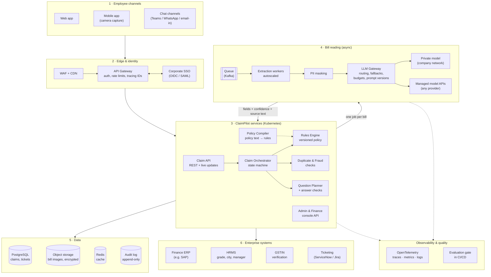
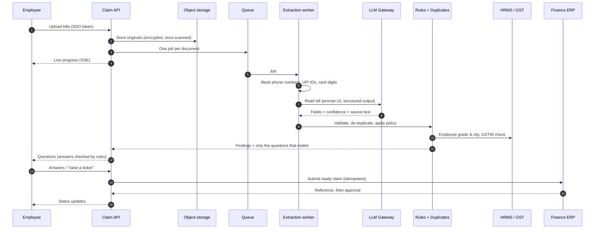
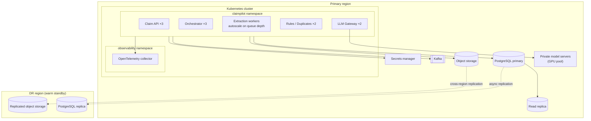
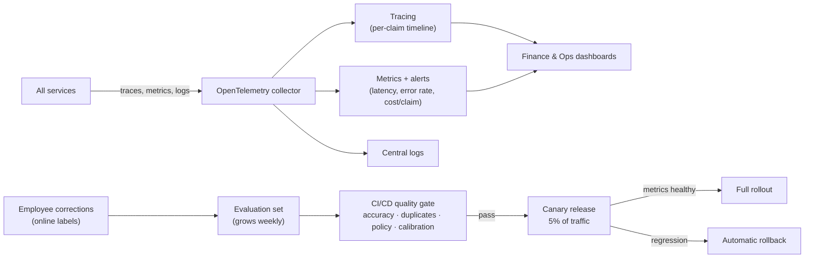

# ClaimPilot — Production Architecture

How the prototype in this repository becomes a production service for thousands of employees. The core design does not change: **the AI only reads documents; deterministic company rules make every decision.** What changes is everything around it: identity, scale, storage, security, integrations and operations.

---

## 1. System overview

**In one line per layer:**
- **Channels:** employees submit bills from the web, the mobile camera, or a chat they already use.
- **Edge:** every request is authenticated through corporate SSO, rate-limited and traced from the first hop.
- **Core services:** the same modules as the prototype, split into independently scalable services.
- **AI layer:** a single gateway in front of all models, so the company can switch or mix providers without touching the app, and keep sensitive bills on a private model.
- **Async processing:** bill reading is queued, so a month-end spike never slows the app down.
- **Data:** claims in PostgreSQL, bill images in encrypted object storage, and an append-only audit trail.
- **Enterprise systems:** real ERP, HRMS, GST verification and ticketing replace today's mocks behind the same interfaces.

---

## 2. A claim, end to end

---

## 3. Deployment view

- **Stateless services, horizontal scale:** every service runs at least two replicas behind the gateway. Extraction workers scale with queue depth, so month-end peaks are absorbed by more workers, not slower responses.
- **Data protection:** PostgreSQL has a primary, a read replica for dashboards, and a warm standby in a second region. Receipt storage is replicated across regions.
- **Secrets:** API keys and database credentials live in a secrets manager, never in images or config files.

---

## 4. Observability and quality loop

- **Every claim is traced** step by step (read → check → rules → questions → submit), with the model, prompt version, time and cost recorded on each step.
- **Alerts** fire on error rate, slow extraction, cost per claim above budget, and a falling first-pass-ready rate.
- **Testing never stops:** every correction an employee makes becomes a test case. No new prompt or model ships unless it passes the same quality gate this prototype runs in CI, then a canary on 5% of traffic.

---

## 5. Security and compliance

| Area | Production approach |
|---|---|
| Identity | Corporate SSO (OIDC/SAML); role-based access: employee, manager, finance, admin |
| Data in transit / at rest | TLS everywhere; encrypted database and object storage with managed keys |
| Personal data | PII masked before any AI call and before storage; original images kept only as long as the retention policy allows |
| AI data residency | Sensitive bills can be routed to a private model inside the company network; external models only via the gateway with no-retention settings |
| Prompt injection | Bills are treated as untrusted input; model output is schema-validated data and never executed as an instruction |
| Audit | Append-only audit log of every finding, answer, override, ticket and submission, with who and when |
| Uploads | Size and type checks, virus scan, images re-encoded to strip metadata |
| Secrets | Secrets manager with rotation; no keys in code or images |

---

## 6. From prototype to production

| Prototype (this repo) | Production |
|---|---|
| Single FastAPI process | Separate services on Kubernetes, at least 2 replicas each |
| In-process background tasks | Kafka queue + autoscaled extraction workers |
| SQLite | PostgreSQL (primary, replica, DR standby) |
| Local `data/uploads` | Encrypted object storage with lifecycle rules |
| Provider switch by environment variable | LLM Gateway: routing, fallbacks, budgets, caching, private model option |
| Mock finance and tickets | ERP and ticketing connectors behind the same interfaces |
| Demo employee profile | HRMS integration: grade-based limits, base city, approving manager |
| Local GSTIN checksum | Checksum plus live GSTIN verification |
| Spans stored in SQLite | OpenTelemetry → tracing, metrics and logs stack with alerting |
| `make eval` in CI | Same gate plus a growing set from real corrections, then canary releases |
| Rule-based answer checks | Rules first, with a small model only for borderline answers |

**Rollout plan:**
1. **Pilot:** one department, read-only ERP sync, Finance reviews every claim.
2. **Assisted:** auto-submit claims with no open findings; Finance reviews flags and tickets only.
3. **Scale:** all departments, grade-based policy, mobile and chat channels, private model for sensitive categories.

**Capacity planning (illustrative):** 50,000 employees × 4 claims a month × 8 bills = about 1.6 million bill reads a month, around 37 reads a minute on average. Month-end peaks of 10× are handled by scaling extraction workers on queue depth.
