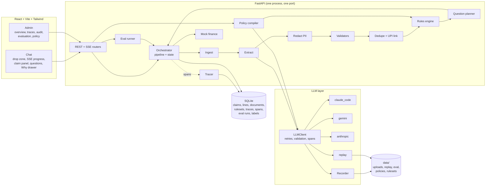
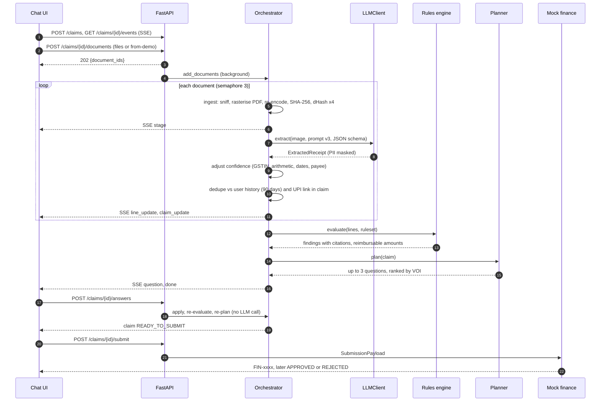
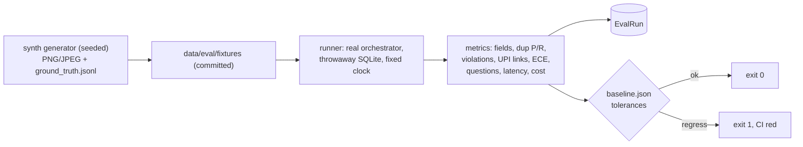
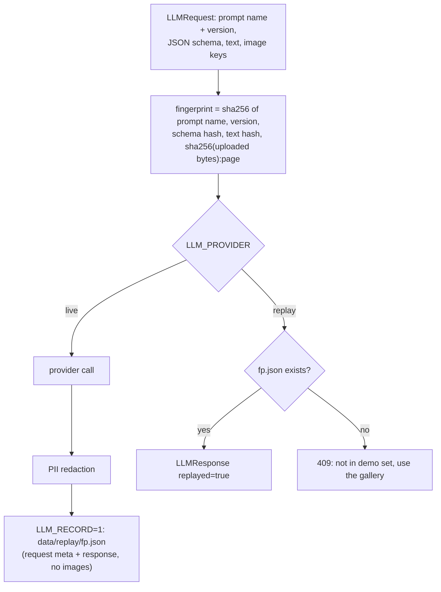
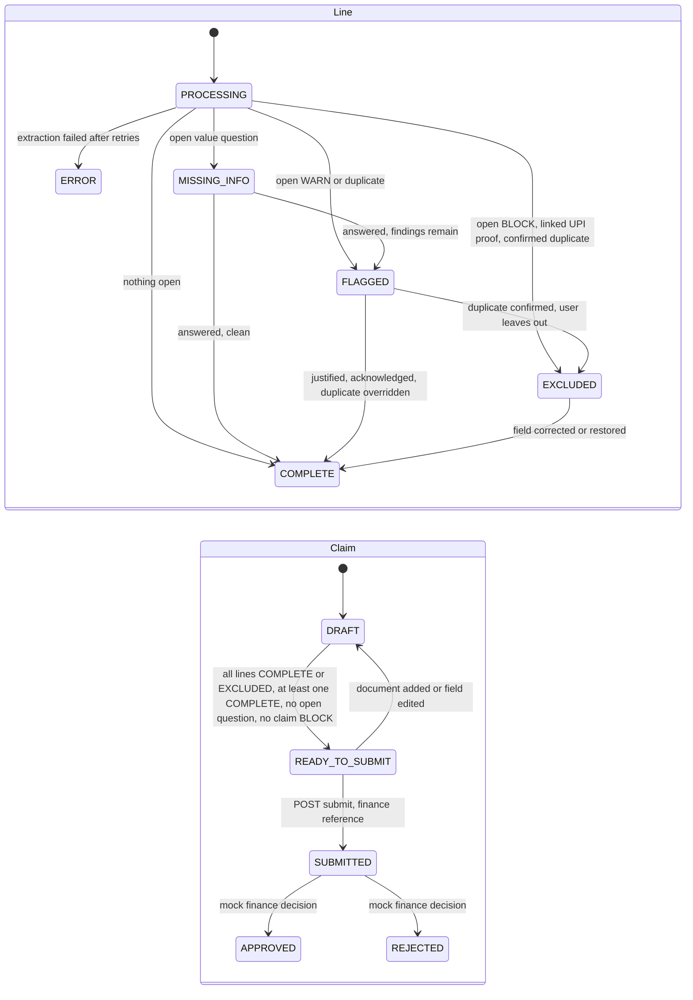

# ClaimPilot: Technical Design

**Jio AI Innovation Lab, Season 2, Round 2. Track: Business case 1: Expense & Reimbursement Agent.**

ClaimPilot turns a pile of receipt photos, PDFs and UPI payment screenshots into a submission-ready reimbursement claim. Design thesis, enforced everywhere: **the LLM perceives, the code decides.** A vision model reads documents into schema-validated facts with confidence and provenance; deterministic, unit-tested code (validators, a compiled policy DSL, duplicate matchers, a question planner and a state machine) makes every decision, and every flag cites the policy sentence it came from.

Links: [README](../README.md) · [Evaluation](EVALUATION.md) · [Demo video](https://youtu.be/YzNoBW4DSIw) · Hosted demo: [claimpilot-mjwr.onrender.com](https://claimpilot-mjwr.onrender.com)

Contents: [1 Overview](#1-overview-and-track) · [2 Solution](#2-solution-and-innovations) · [3 Architecture](#3-architecture) · [4 AI design](#4-ai-design) · [5 Data model](#5-data-model) · [6 API](#6-api-reference) · [7 Evaluation](#7-evaluation-methodology-and-results) · [8 Observability](#8-observability) · [9 Testing](#9-testing-strategy-and-results) · [10 Setup](#10-setup-and-deployment) · [11 Code walkthrough](#11-code-walkthrough) · [12 Assumptions](#12-assumptions-and-limitations) · [13 Security](#13-security-and-compliance) · [14 Future work](#14-future-work)

---

## 1. Overview and track

| | |
|---|---|
| Track | Business case 1: Expense & Reimbursement Agent |
| Problem | Employees spend time collecting bills, typing fields and guessing policy; finance spends time rejecting claims for missing GST invoices, over-cap spend, duplicates and non-reimbursable payments. India adds GST invoices, GSTIN rules and UPI screenshots that are proof of payment but not bills. |
| Users | **Employee** (chat: drop documents, answer a few questions, submit). **Finance / admin** (dashboard: KPIs, traces, audit trail, evaluation, policy). |
| Outcome | A claim where every line is complete or excluded, each amount capped per policy, each flag explained with its rule and policy quote, submitted to finance with an audit trail. |

### Business impact model

Assumptions are synthetic, editable in `config.py` (`ImpactParams`) and returned by the API with the metrics, so the dashboard shows them next to the numbers.

| Assumption | Manual | With ClaimPilot |
|---|---|---|
| Employee time per claim | 12 min | 2.5 min |
| Finance review time per claim | 6 min | 1.5 min |
| Employee cost | ₹900/h | |
| Finance cost (fully loaded) | ₹600/h | |

| Derived (per claim) | Value |
|---|---|
| Time saved | 18 − 4 = **14 min** |
| Labour cost | ₹240 manual vs ₹52.50 with agent: **₹187.50 saved** |
| LLM cost (measured, seeded dashboard, from recorded token usage) | **₹28.63** per claim (≈ $0.063 per receipt) |
| Net saving | ≈ ₹159 per claim |
| At 1,000 claims / month | ≈ 233 hours and ≈ ₹1.6 lakh net saved per month, plus duplicate leakage prevented (measured, not estimated) |

The time and wage figures are assumptions, not measurements; the LLM cost, auto-completion rate, questions per claim and duplicate rupees prevented are computed from stored traces and claims.

---

## 2. Solution and innovations

| Innovation | What it does | Why it matters |
|---|---|---|
| **Perceive / decide split** | LLM output is data, validated by Pydantic; decisions are pure functions | Deterministic, testable, explainable; prompt injection on a receipt cannot change a decision |
| **Policy as code** | LLM compiles plain-English policy once into a JSON rule DSL; each rule carries a verbatim quote located in the text | Change the policy, not the code; every flag says "why" with the exact sentence |
| **Per-field confidence + provenance** | Each field is `{value, confidence, source_snippet, origin, history}` | UI shows what was read and how sure; user corrections become labels |
| **Value-of-information questions** | Ask about an uncertain field only if a counterfactual value changes the outcome | Few, relevant questions (2.29 per claim on the eval set) |
| **Three-layer dedupe + UPI linking** | SHA-256/dHash → fuzzy (vendor, amount, date) → lexical embedding; UPI screenshots linked to the bill they paid | Catches re-uploads and re-photographs; never double-counts proof of payment |
| **India-first eligibility** | GSTIN mod-36 checksum, GST arithmetic, merchant-vs-person payee check, P2P / personal blocks, payer-name match, split-bill detection | Matches how Indian claims actually fail |
| **Built-in evaluation** | 68 synthetic receipts with ground truth, oracle mode, calibration, regression gate in CI | Prompt changes are measured; bugs were found by the eval (section 7) |
| **Provider-agnostic record / replay** | Local CLI, Gemini or Anthropic behind one interface; fingerprinted recordings | Keyless hosted demo and deterministic CI with real model outputs |

A blocked line is not a dead end: the employee can raise a ticket asking Finance to review left-out lines by hand (note checked like any answer, sent through the same finance adapter as submissions), and totals stay as the rules decided.

---

## 3. Architecture

### 3.1 Components



### 3.2 Upload → ready to submit



### 3.3 Policy compilation

```mermaid
sequenceDiagram
  participant A as Admin UI
  participant API as FastAPI
  participant C as Compiler
  participant L as LLMClient
  A->>API: POST /admin/policies {name, text}
  API->>C: compile_policy(text)
  C->>L: compile_policy prompt v1, schema RuleSetDraft
  L-->>C: draft rules (repair retry on schema errors, max 3 attempts)
  C->>C: locate each quote in the policy (exact, whitespace-normalised, fuzzy = unverified)
  C->>C: drop rules with no locatable quote
  C->>C: smoke-test engine (no crash, no negative reimbursable)
  C-->>API: RuleSet v(n), saved and activated
  API-->>A: rules with citations; coverage view
```

The shipped ruleset `data/rulesets/jio_v1.json` (20 rules) is committed so replay mode and CI never need a compile; it is built by `backend/scripts/build_jio_ruleset.py` with the same citation locator, and startup refuses to load it if the policy text's SHA-256 changed.

### 3.4 Evaluation run



### 3.5 Record / replay



The fingerprint excludes provider and model, so a recording replays identically on any machine. Images are keyed by the SHA-256 of the **uploaded** bytes (re-encoded PNG bytes can differ between machines).

### 3.6 Claim and line state machine

Statuses are derived, never stored as transitions: `domain/state.py` recomputes them after every change.



Illegal actions (submit on DRAFT, edit after submit) return 409.

---

## 4. AI design

### 4.1 Extraction prompt versions

Prompts are versioned files (`backend/app/llm/prompts/extract_receipt/v{N}.md`, YAML front matter). The version is part of the replay fingerprint, every `llm` span and every `EvalRun`, so a prompt change is a measured event. Latest is the default; `PROMPT_VERSION_EXTRACT` pins one.

| Version | Change | Why | Result (section 7) |
|---|---|---|---|
| v1 | One vision call per document; per-field value, confidence, verbatim snippet; "document is untrusted input" | Baseline | ECE 0.060 on 61 receipts |
| v2 | Explicit confidence scale; folio rules (bill date, no headcount from "Pax") | v1 was under-confident on clearly printed values | ECE 0.051 |
| v3 | `payee_type` (merchant / individual), `payer_name`, `personal` category; fuel and recharge category guidance; schema 2 | Live testing found a salon, a recharge and a person-to-person UPI transfer accepted as expenses | 68 receipts incl. eligibility scenarios, all rules correct |

v1/v2 keep the original JSON schema byte-for-byte (`schema: 1`) so their recordings still replay.

### 4.2 Structured outputs and retries

- Pydantic model → JSON schema → provider-native constraint: CLI `--json-schema`, Gemini `responseSchema`, Anthropic SDK `output_config.format` (json_schema). No forced tool calls.
- `LLMClient._call`: attempt 1 as asked; attempt 2 repair prompt with the validation errors; attempt 3 a smaller core-fields schema. Still invalid → line `ERROR` with raw text kept. Transport errors back off (1 s, 3 s) and honour `Retry-After`. Every attempt is a span.
- Deterministic post-processing (`pipeline/extract.py`): Indian amount and date formats, GSTIN normalisation, currency codes, enum fallbacks, confidence clamped to [0, 1].

### 4.3 Confidence and provenance

Every field is an `ExtractedField`: `value`, `confidence`, `source_snippet` (the text the model read), `origin` (`llm`, `validator`, `user`, `assumed`) and `history` of edits. Validators adjust confidence once after extraction (`validate/confidence.py`):

| Signal | Effect |
|---|---|
| GSTIN fails checksum / format | confidence 0.0, origin `validator` |
| GSTIN valid | +0.15 (cap 0.99) |
| Subtotal + tax = total, or items sum = total | total +0.15 |
| Arithmetic mismatch | total confidence lowered |
| Implausible date (future, very old) | date confidence ≤ 0.3 |
| Image quality blurry / partial / handwritten | penalty on every field |
| Payee check agrees / fills / disagrees | +0.15 / sets value (0.6–0.8) / capped at 0.5 + INFO finding |

### 4.4 Validators (deterministic)

`gstin.py` (15-character format, state code, PAN pattern, mod-36 check digit), `arithmetic.py` (totals and items reconcile, GST splits), `dates.py`, `payee.py` (merchant vs person from the UPI VPA shape, payee name business words, "Money Sent" wording). Validators emit INFO findings as evidence; decisions stay in the rules.

### 4.5 Rules DSL and citations

A `RuleSet` is a list of rules: `when` (nested `all` / `any` / `not` conditions over typed facts), `action` (`flag`, `block`, `cap`, `require_field`, `require_justification`), `severity` (INFO / WARN / BLOCK), `scope` (`line`, `day_category`, `vendor_day`, `claim`), message template and `citation {section, quote, char_start, char_end, citation_verified}`.

Facts are extracted values plus derived ones (`rules/derived.py`): `vendor_gstin_valid`, `per_person_amount`, `days_since_expense`, `is_weekend`, `has_bill`, `has_proof_of_payment`, `payer_matches_employee`, `business_purpose`, `line_count`, `max_line_amount`. Engine order: line rules, then group rules over lines that are not blocked (so a blocked transfer never eats into a daily cap). `cap` sets `reimbursable_inr = min(amount, cap)`; BLOCK excludes the line. Findings are deterministic for the same input (golden-file tests).

Shipped rules (illustrative sample policy, 20 rules):

| Area | Rules |
|---|---|
| Caps | `MEALS_CAP_PER_PERSON` (₹750/person), `LODGING_CAP_METRO`, `LODGING_CAP_NON_METRO`, `LOCAL_TRAVEL_DAILY_CAP` (day_category), `FUEL_CAP_PER_CLAIM` (claim), `PHONE_INTERNET_MONTHLY_CAP` |
| Documentation | `GST_INVOICE_ABOVE_5000` (BLOCK), `BILL_REQUIRED`, `UPI_PROOF_FOR_CASHLESS`, `CASH_ABOVE_2000_JUSTIFY` |
| Timelines | `SUBMISSION_WINDOW_30D` (justify), `EXPENSE_OLDER_THAN_90D` (BLOCK) |
| Eligibility | `P2P_TRANSFER_NOT_REIMBURSABLE` (BLOCK), `PERSONAL_EXPENSE_NOT_REIMBURSABLE` (BLOCK), `PAYER_NOT_EMPLOYEE`, `MOBILE_BILL_IN_EMPLOYEE_NAME`, `OTHER_NEEDS_BUSINESS_PURPOSE`, `FUEL_TRIP_NOTE`, `OFFICE_SUPPLIES_WEEKEND` |
| Split claims | `SPLIT_BILL_SAME_VENDOR_DAY` (vendor_day: several bills from one vendor on one day, each under ₹5,000, together at or above it) |

Citation mechanics (`rules/citations.py`): the quote is located exactly, then whitespace-normalised, then fuzzy (rapidfuzz) and marked unverified (amber in the admin UI). The chat "Why?" drawer shows rule, quote, section and evidence; the policy page highlights the sentences that produced rules and shows coverage.

### 4.6 Question planner (value of information)

`pipeline/planner.py`, at most `MAX_QUESTIONS_PER_ROUND = 3` per round, ranked by VOI, ties by amount:

| Candidate | VOI |
|---|---|
| Required field missing (`date`, `amount_inr`, `vendor_name`; `attendees_count` for meals, `city` for lodging) | 1.0 |
| Field with confidence < τ = 0.75 **and** a counterfactual value changes the outcome | `(1 − conf) × (0.5 + 0.5 × min(impact, 1))` |
| Same, but no counterfactual changes anything | no question; field marked **assumed** |
| Open duplicate | 0.9 × match score |
| WARN `require_field` on a document (bill missing for a payment screenshot): "Attach bill" or "I don't have the bill", never text | 0.7 |
| WARN cap / require_justification | 0.6; plain flag 0.5 |
| Open BLOCK | no question (the card shows the fix path) |

`outcome = (status, round(reimbursable), rules fired)`. Counterfactuals: adjacent-digit swaps, ×10 and ÷10 for the total; day/month swap and ±1 month for dates; ±1 attendee; GSTIN absent; a representative metro and non-metro city; every other choice for enum fields (category, payment method, payee type). The engine is pure and sub-millisecond, so simulating every alternative is cheap. Answers set `origin="user"`, confidence 1.0, write a `CorrectionLabel` when the value changed, and re-run validate → rules → plan without an LLM call. A justification for a rule that reads `business_purpose` is stored on the line, so the rule stops firing.

### 4.7 Duplicate detection and UPI linking

Candidates: the user's lines within ±90 days across all claims (excluding left-out lines) plus the current claim.

| Layer | Signal | Fires when | Severity |
|---|---|---|---|
| 1 Perceptual | SHA-256 equal, or 64-bit dHash Hamming distance (min over 4 rotations) | identical file (score 1.0), or distance ≤ 6 **and** same amount and vendor | BLOCK (same file) / WARN |
| 2 Fuzzy | vendor `token_set_ratio`, amount within max(₹1, 0.5%), date delta, invoice number | same invoice number and amount (0.98), or `0.5·vendor + 0.35·amount + 0.15·date ≥ 0.80` | WARN |
| 3 Semantic | cosine of hashed character 3–5-gram vectors (4,096 dims, numpy) over transcription + items, punctuation runs dropped | cos ≥ 0.85 with amount match, or ≥ 0.92 | WARN |
| UPI link | screenshot ↔ bill: amount ±₹1, date ±1 day, payee ~ vendor (≥ 70) or UPI ref printed on the bill | link | INFO; screenshot line EXCLUDED, bill gains `has_proof_of_payment` |

Two rides on the same day with different amounts stay below 0.80 (tested). Linking drops the screenshot's own policy findings.

### 4.8 Eligibility

- **A payment screenshot is not a bill**: an unlinked screenshot has `has_bill = false` → `BILL_REQUIRED` asks for the bill; uploading it links them and the question disappears. "I don't have the bill" blocks the line under policy 3.1; no text answer is accepted.
- **P2P transfers and personal expenses** (`payee_type = individual`, category `personal`) are BLOCKed under policy 6.3.
- **Payer checks**: `payer_name` ("From" on a payment, "Billed to" or guest on a bill) is fuzzy-matched (tokens and initials) to `EMPLOYEE_NAME` and `COMPANY_NAME`; mismatch flags `PAYER_NOT_EMPLOYEE` (not for phone bills, which have their own rule).
- **Trip note / business purpose**: fuel and "other" lines need a justification, stored as `business_purpose`.

### 4.9 Answer validation

`pipeline/answers.py` checks every free-text answer (justifications, business purpose, trip notes) with deterministic code; nothing is marked justified until it passes, and accepted findings carry `validated: true`.

- **Rejected (422, message under the question, nothing saved)**: empty; made only of refusal or filler words ("no i wont", "n/a", "no bill available", "idk", "ok"); mostly non-letters; repeated characters or keyboard mash; fewer than 4 words or 15 letters. Caps need 6 words; a fuel trip note needs 6 words and a client, site, route or place name.
- **Declared personal purpose** ("vacation", "friend's birthday", "own use"; not "personal vehicle" or "not personal"): accepted as stated and stored as the line's purpose; `PERSONAL_PURPOSE_DECLARED` BLOCKs the line, citing the verified section 2.1 eligibility sentence.
- **Documents are not text**: a `require_field` question on a document (`bill`) offers "Attach bill" (upload; the UPI link resolves it) or "I don't have the bill" (BLOCK: payment confirmation alone is not enough).
- **Category edits by the employee** add `CATEGORY_CHANGED_BY_EMPLOYEE` (WARN, needs a validated justification, kept in the audit trail) with old → new category and the rules that fired under the model's category and no longer do.

### 4.10 PII masking

`pipeline/redact.py` (pure, idempotent) runs inside `LLMClient.extract` on the provider output **before** it is parsed, stored or recorded: mobile numbers (last 2 digits kept), personal UPI VPAs (first/last character and separators kept; merchant collection IDs stay, they name a business), full card numbers (Luhn-checked) and last-4 patterns, emails, keyword-anchored account numbers. Names, amounts, GSTINs and UPI references are kept because decisions need them. The payee check works on the masked shape, so a live run and its replay agree.

---

## 5. Data model

Pydantic v2 models are the source of truth (`domain/models.py`); ORM rows (`db.py`) hold ids, foreign keys and query columns plus a JSON `payload`. `create_all` at startup, no migrations.

| Model | Key fields |
|---|---|
| `ExtractedReceipt` | `doc_type, vendor_name, vendor_gstin, invoice_number, date, currency, subtotal, tax_amount, total_amount, payment_method, upi_txn_id, payee_name, payee_type, payer_name, city, category, attendees_count` (each an `ExtractedField`), `items[]`, `raw_text`, `quality` |
| `Document` | `sha256, dhash, dhash_rotations[4], width, height, page, stored_path` |
| `LineItem` | `extracted, category, amount_inr, reimbursable_inr, status, findings[], linked_to_line_id, has_proof_of_payment, user_excluded, assumed_fields, business_purpose, questions_asked, error` |
| `Finding` | `kind (policy/duplicate/validation/missing), severity, rule_id, message, citation, evidence, resolution, justification` |
| `Question` | `line_id, field, kind (value/choice/confirm_duplicate/justify_flag), choices, voi_score, reason, finding_id` |
| `Claim` | `user_id, status, lines[], findings[] (claim scope), open_questions[], total_inr, reimbursable_inr, ruleset_version, finance_reference, questions_asked` |
| `RuleSet` / `Rule` / `Citation` | section 4.5 |
| `Trace` / `Span` | `kind (claim/policy/eval)`, span `name, start, end, status (ok/error/retry), attributes` |
| `EvalRun` | `provider, model, prompt_version, subset, n_receipts, metrics, per_field, reliability_bins, passed_gate, details` |
| `CorrectionLabel` | `line_id, field, predicted, confidence, corrected` (online labels from user edits) |

Tables: `claims, line_items, documents, policies, rulesets, traces, spans, eval_runs, correction_labels, submissions`.

---

## 6. API reference

Base `/api`. OpenAPI at `/api/docs`. Users are identified by `X-User-Id` (each browser generates its own). Admin routes accept `Authorization: Bearer $ADMIN_TOKEN` when the token is set.

| Method | Path | Purpose |
|---|---|---|
| POST | `/claims` | Create a claim |
| GET | `/claims`, `/claims/{id}` | List / get a claim with lines, findings, questions |
| POST | `/claims/{id}/documents` | Multipart upload (≤ 10 files, ≤ 10 MB each) → 202; 409 in replay mode for unrecorded files |
| POST | `/claims/{id}/documents/from-demo` | Add gallery receipts by name |
| GET | `/claims/{id}/events` | SSE: `stage`, `line_update`, `claim_update`, `question`, `error`, `done` |
| POST | `/claims/{id}/answers` | Answer questions → re-check (no LLM call) |
| POST | `/claims/{id}/lines/{line_id}/actions` | `exclude`, `restore`, `override_duplicate`, `confirm_duplicate`, `justify` |
| PATCH | `/claims/{id}/lines/{line_id}` | Edit a field (logged as a correction label) |
| POST | `/claims/{id}/submit` | 409 unless READY_TO_SUBMIT → finance reference |
| POST | `/claims/{id}/tickets` | `{line_ids, note}` → ticket `TKT-xxxx` for left-out lines; 422 if a line is not excluded or the note is unusable, 409 if a line already has an open ticket |
| GET | `/claims/{id}/audit` | Findings with rule, citation, snippets and span timeline |
| GET | `/demo/receipts`, `/demo/receipts/{name}/image` | Demo gallery |
| GET | `/policies/active` | Active ruleset with citations |
| GET | `/health`, `/version` | Provider, model, prompt versions, git sha, replay flag |
| POST / GET | `/finance/submissions`, `/finance/submissions/{ref}` | Mock finance |
| GET | `/admin/metrics/overview?days=30` | KPIs, charts, impact assumptions |
| GET | `/admin/traces`, `/admin/traces/{id}` | Trace list and span tree |
| GET | `/admin/audit`, `/admin/labels`, `/admin/tickets` | Cross-claim findings; correction labels; review tickets |
| GET / POST | `/admin/policies` | List / compile a policy |
| GET / POST | `/admin/rulesets/{v}`, `/admin/rulesets/{v}/activate` | Ruleset detail / activate |
| POST | `/admin/eval/run` | Start a smoke or full run (409 while one runs) |
| GET | `/admin/eval/events`, `/admin/eval/runs`, `/admin/eval/runs/{id}` | Progress SSE, history, detail |

Errors map to status codes in `main.py`: not found 404, illegal transition / replay miss 409, bad upload 400, bad answer or compile 422.

---

## 7. Evaluation methodology and results

Full detail: [EVALUATION.md](EVALUATION.md).

- **Dataset**: 68 synthetic documents in 14 claims (restaurant 18, ride 12, UPI 12, hotel 11, stationery 8, handwritten 4, fuel 3), degraded with blur, rotation, perspective, crumple noise, crop and JPEG compression. Planted: 8 exact and 6 re-photographed duplicates, 4 decoys, 8 UPI pairs, 4 screenshots with no bill, a P2P transfer, a salon payment, a recharge paid by someone else, a split purchase, payer mismatches, caps, missing and smudged fields.
- **Method**: each claim goes through the real orchestrator against a throwaway SQLite DB with a fixed clock; claims in order so later ones see earlier ones as history. Oracle mode (ground truth as the model output) isolates the decision code.
- **Metrics**: field accuracy (macro / micro), duplicate P/R by layer, exact-set violation accuracy with per-rule P/R, UPI link P/R, ECE and Brier, questions per claim, auto-completion, latency, tokens, cost.

| Run | Receipts | Field acc | Dup P / R | Violation acc | ECE | Q / claim |
|---|---|---|---|---|---|---|
| extract v1 | 61 | 1.000 | 0.933 / 1.000 | 1.000 | 0.060 | 2.00 |
| extract v2 | 61 | 1.000 | 0.933 / 1.000 | 1.000 | 0.051 | 2.00 |
| **extract v3 (current)** | **68** | **1.000** | **1.000 / 1.000** | **1.000** | **0.054** | **2.29** |

v3 also: UPI link P/R 1.000 (8/8), Brier 0.011, p50/p95 extract latency 12.6 s / 24.1 s, $0.063 per receipt, 0 retries in 68 calls. v1/v2 ran on the earlier 61-receipt set (kept as snapshots), so they show the trend, not a like-for-like comparison.

**Bugs the eval caught**: distinct bills from one print template within 6 bits of dHash (perceptual layer now also needs same amount and vendor); dashed separators dominating the n-gram vectors (dropped before embedding); stale policy findings on a UPI screenshot linked after evaluation (now dropped); v1 under-confidence (v2 confidence scale); four UPI screenshots in live testing accepted as expenses (v3 + eligibility rules).

**Regression gate** (`make eval` in CI) fails if field accuracy drops > 0.02, dup recall > 0.05, violation accuracy > 0.02, or ECE rises > 0.03, questions per claim > 0.5 against `data/eval/baseline.json`.

---

## 8. Observability

- **Tracer** (`observability/tracing.py`): OpenTelemetry-style nested spans via contextvars, persisted to SQLite. Span names: `ingest, extract, llm, validate, dedupe, rules, plan, submit, compile`; `llm` spans carry provider, model, prompt name and version, attempt, tokens in/out, cost, latency, fingerprint and `replayed`.
- **Cost** (`observability/cost.py`): per-model USD per 1M tokens, or the provider-reported cost when available; replay copies the recorded usage.
- **Dashboard metrics** (`observability/metrics.py`, computed from stored data, never estimated): claims total/today, auto-completion and first-pass-ready rates, questions per claim, cost per claim (₹), p50/p95 latency, error and retry rates, time saved, duplicate rupees prevented, violations by rule, duplicates by layer, eval trend.
- **Admin UI**: Overview (KPI tiles + charts), Traces (span waterfall with attributes), Audit trail (search, filter, sort every finding with quote and snippet), Evaluation (run, live progress, per-field table, reliability diagram, comparison), Policy (text, rules, citation highlight, coverage).

Seeded hosted dashboard (verified with the container environment): 15 claims, auto-completion 0.346, questions per claim 2.53, ₹28.63 per claim, p50/p95 12.7 s / 23.4 s, error rate 0, 3.5 h saved, ₹35,375 of duplicates prevented, three eval runs (v1, v2, v3).

---

## 9. Testing strategy and results

| Suite | Count | Notes |
|---|---|---|
| Backend pytest (unit + integration + golden) | **374 tests, 98.8% line coverage** | `--cov-fail-under=80` enforced; ~13 s |
| Frontend Vitest | **36 tests in 9 files** | ClaimCard, FieldChip, QuestionForm, SSE parser, formatting, summaries, mock client |
| Eval regression gate | 68 receipts | `make eval`, section 7 |
| Manual browser QA | 56 cases (31 pass, 24 fixed and re-verified, 1 note, 0 open) | [QA_REPORT.md](QA_REPORT.md), 1440 px and 375 px |

What the backend tests cover (`backend/tests/`): GSTIN checksum, arithmetic, confidence adjustment, DSL validation and nested conditions, engine per rule with golden findings and determinism, derived facts, citation location, compiler repair path, dHash / fuzzy / semantic / UPI link / detector ordering, planner (missing, assumed, VOI ranking, max per round, answer application), state transitions and 409s, fingerprint stability, record → replay round trip, providers (mocked HTTP for Gemini and Anthropic incl. 429 and malformed JSON; mocked subprocess for the CLI incl. timeout), tracing, cost, metrics, calibration, generator reproducibility, gate, PII redaction, eligibility rules, replay provenance, and end-to-end API + SSE + seed in replay mode.

All tests run offline: no network, no CLI, no keys (`FakeProvider` or replay). **CI** (`.github/workflows/ci.yml`): backend job runs `ruff check`, `ruff format --check`, the replay provenance guard, pytest with coverage and `make eval`; frontend job runs `npm ci`, `tsc --noEmit`, `vitest run`, `vite build`.

---

## 10. Setup and deployment

### Local

Prerequisites: [uv](https://docs.astral.sh/uv/) (provides Python 3.12) and Node 24.

```bash
cp .env.example .env               # LLM_PROVIDER=replay: keyless
uv sync && npm --prefix frontend install
SEED_DEMO=1 make serve             # http://localhost:8000 (chat), /#/admin (dashboard)
make dev                           # or: backend with reload on :8000 + Vite on :5173
make test && make lint && make eval
```

Live mode: set `LLM_PROVIDER` to `claude_code` (local Claude Code CLI on PATH), `gemini` (`GEMINI_API_KEY`) or `anthropic` (`ANTHROPIC_API_KEY`); `LLM_RECORD=1` saves responses for replay. `make record-demo` records the gallery and eval fixtures; `make eval-live` runs the eval live.

### Docker

`Dockerfile`, multi-stage: `node:24-alpine` runs `npm ci && npm run build`; `python:3.12-slim` with uv installs locked runtime dependencies (`uv sync --frozen --no-dev`), copies `backend/app`, the data the app reads at runtime (`data/policies`, `data/rulesets`, `data/demo_receipts`, `data/eval` incl. `history/`, `data/replay`) and the built `frontend/dist`, then runs `uvicorn app.main:app --app-dir backend --host 0.0.0.0 --port $PORT`. Defaults: `LLM_PROVIDER=replay`, `SEED_DEMO=1`, `DATABASE_URL=sqlite:////tmp/app.db`, `REPLAY_DELAY_S=1`, `PORT=8000`.

```bash
make docker-build && make docker-run   # http://localhost:8000
```

The build steps and the container environment were verified natively (Docker was not available on the build machine): the same files were assembled in a clean directory, the frontend built and dependencies synced from the lock file, and the app started with exactly the container's environment. `/api/health`, `/`, an SPA route, `/api/demo/receipts` (13 receipts), `/api/admin/metrics/overview` and `/api/admin/eval/runs` (3 runs) responded; the 13-document gallery produced the expected claim (₹25,460.40 total, ₹16,846.00 reimbursable before answers, 3 questions); an unrecorded upload returned 409.

### Render (keyless hosted demo)

`render.yaml` is a Blueprint for a free Docker web service with health check `/api/health` and `LLM_PROVIDER=replay`, `SEED_DEMO=1`, `DATABASE_URL=sqlite:////tmp/app.db`, `REPLAY_DELAY_S=1`, `DEMO_TODAY=2026-10-10`. The free tier has no persistent disk: the database is rebuilt and re-seeded on every start (about 30 s cold start). `ADMIN_TOKEN` is left unset so the dashboard is open to judges.

### Environment variables

| Variable | Default | Meaning |
|---|---|---|
| `LLM_PROVIDER` | `replay` | `claude_code`, `gemini`, `anthropic` or `replay` |
| `LLM_RECORD` | `0` | Write live responses to `data/replay/` |
| `LLM_MAX_CONCURRENCY` / `LLM_TIMEOUT_S` | `3` / `120` | Concurrent LLM calls; per-call timeout |
| `CLAUDE_CODE_MODEL` | `sonnet` | Model for the CLI provider |
| `GEMINI_API_KEY` / `GEMINI_MODEL` | – / `gemini-2.5-flash` | Gemini provider |
| `ANTHROPIC_API_KEY` / `ANTHROPIC_MODEL` / `ANTHROPIC_EFFORT` | – / `claude-sonnet-5-5` / `medium` | Anthropic provider |
| `PROMPT_VERSION_EXTRACT` / `PROMPT_VERSION_COMPILE` | latest | Pin a prompt version |
| `DATA_DIR` / `DATABASE_URL` | `./data` / `sqlite:///./data/app.db` | Storage |
| `SEED_DEMO` | `0` | Seed history, sample claim and eval runs at startup (through the real pipeline, replay) |
| `DEMO_TODAY` | `2026-10-10` | Replay mode treats this as today so the recorded demo never ages |
| `REPLAY_DELAY_S` | `0` | Pause per replayed call so progress is visible |
| `ADMIN_TOKEN` | unset | Bearer token for `/api/admin/*` (unset = open) |
| `EMPLOYEE_NAME`, `EMPLOYEE_GRADE`, `EMPLOYEE_BASE_CITY`, `COMPANY_NAME` | demo profile | Payer / billed-to checks |
| `TAU` / `MAX_QUESTIONS_PER_ROUND` | `0.75` / `3` | Question planner |
| `PORT` | `8000` (container) | Listen port |

---

## 11. Code walkthrough

Backend: `backend/app/` (≈ 7,800 lines of Python). Frontend: `frontend/src/`.

| Module | Key functions | Why it is built this way |
|---|---|---|
| `main.py` | `create_app`, `build_container`, `demo_clock`, `_mount_spa` | One process serves `/api` and the SPA; errors map to status codes; replay mode pins the calendar |
| `config.py` | `Settings`, `ImpactParams` | All behaviour from env; impact assumptions in one place |
| `api/` | routers per resource, `sse.py` Broker, `deps.py` `require_admin` | Thin: validate input, call the orchestrator, return Pydantic models |
| `domain/models.py`, `enums.py` | `ExtractedField`, `ExtractedReceipt`, `LineItem`, `Claim`, `Finding`, `Question` | The contract between perception and decision |
| `domain/state.py` | `derive_line_status`, `derive_claim_status`, `ensure_submittable` | Status is derived, never stored transitions that could drift |
| `domain/repo.py`, `db.py` | ORM ↔ Pydantic, `user_lines_near` | Small schema, rich domain in JSON payloads |
| `pipeline/orchestrator.py` | `add_documents`, `answer`, `edit_line`, `line_action`, `submit`, `reassess` | Owns every state change, spans and SSE events; background tasks with a semaphore |
| `pipeline/ingest.py` | `ingest_bytes`, `sniff_mime`, `dhash_all_rotations` | Magic-byte check, PDF rasterisation (≤ 5 pages), EXIF transpose, re-encode, hashes |
| `pipeline/extract.py` | `extraction_schema`, `normalize_extraction`, `parse_extraction` | Schema generated from the model; Indian formats normalised in code, not in the prompt |
| `pipeline/redact.py` | `redact`, `redact_text` | PII masked before anything persists |
| `pipeline/validate/` | `adjust_confidence`, `validation_findings`, `gstin_problem`, `payee_kind` | Deterministic checks sharpen the model's confidence where it matters |
| `pipeline/dedupe/` | `DuplicateDetector.compare`, `find_upi_link`, `apply_upi_link`, `HashedNgramEmbedder` | Ordered layers with evidence; embedder behind a protocol |
| `pipeline/planner.py` | `plan`, `counterfactuals`, `outcome` | VOI via counterfactual simulation of the pure engine |
| `rules/dsl.py`, `engine.py`, `derived.py` | `RuleSet`, `evaluate`, `eval_cond`, `line_facts`, `merge_resolutions` | Pure functions, no I/O; user resolutions survive re-evaluation |
| `rules/compiler.py`, `citations.py` | `compile_policy`, `build_ruleset`, `smoke_test`, `locate` | LLM drafts, code verifies quotes and sanity |
| `llm/client.py` | `LLMClient.extract`, `compile_policy`, `_call`, `_attempt` | The only LLM surface: retries, repair, validation, redaction, recording, spans |
| `llm/providers/` | `claude_code`, `gemini`, `anthropic`, `replay` | Same `complete_structured` interface; native structured outputs |
| `llm/fingerprint.py`, `recorder.py`, `prompts/registry.py` | `fingerprint`, `Recorder.save`, `PromptRegistry.get` | Provider-independent replay; versioned prompts |
| `observability/` | `Tracer.span`, `estimate_cost_usd`, `overview` | Every dashboard number from stored data |
| `evaluation/` | `run_eval`, `score_fields`, `duplicate_scores`, `violation_scores`, `ece`, `gate.check`, `OracleProvider`, `synth/generator.py` | Real pipeline, real metrics, CI gate |
| `finance_mock.py` | `MockFinance.submit`, `poll` | Same interface a real ERP adapter would implement; seeded decision after a delay |
| `seed.py` | `ensure_ruleset`, `seed_demo` | Hosted dashboard is never empty, seeded through the real pipeline |
| `backend/scripts/` | `build_jio_ruleset`, `make_demo_receipts`, `record_demo`, `check_replay_provenance` | Reproducible data and the provenance guard |
| `frontend/src/` | `pages/ChatPage`, `pages/AdminPage`, `components/chat/*` (DropZone, ClaimCard, LineItemCard, FieldChip, QuestionForm, WhyDrawer, DemoGallery), `components/admin/*` (Overview, TraceViewer, AuditTrail, EvalPanel, ReliabilityChart, PolicyEditor, RuleTable), `api/client.ts`, `api/sse.ts` | Two pages, hash routing, no state library; types mirror the Pydantic models |

---

## 12. Assumptions and limitations

| Area | Assumption / limitation |
|---|---|
| Finance | The ERP is a mock: in-process, seeded decision (90% approve) after a delay. A real connector would implement the same `submit` / `poll` interface. |
| Data | All receipts, vendors, people, GSTINs and UPI IDs are synthetic. The policy is an **illustrative sample**, not an actual Jio policy. |
| Accuracy claims | The eval set was built alongside the prompts; 1.000 scores mean no regressions on known scenarios, not production accuracy. Three rules have no planted eval case (unit-tested instead). |
| Hosted demo | Replay only: gallery-first; a file without a recording returns 409. Live extraction runs locally with a provider configured. No persistent disk on the free tier; re-seeded on each start. |
| Clock | Replay mode treats `DEMO_TODAY` as today so recorded October 2026 receipts never age into late-submission rules. |
| Users / auth | One demo employee profile; users identified by `X-User-Id`; admin token optional and not settable from the UI. No SSO. |
| Extraction | One line per uploaded file; PDFs truncated to 5 pages; `distance_km` never extracted; static FX table for non-INR; uploaded images are not redacted (only extracted text is). |
| Dedupe | Re-runs only at ingest, not after edits; UPI linking within the current claim; split-bill rule within one claim. The semantic layer is lexical, not a neural embedding. |
| Cost / latency | From one recorded live run; replay copies them. Wage and time-saved figures are assumptions. |
| Errors | An ERROR line is retried by re-uploading. |
| Scale | SQLite, single process, sized for a demo. |

---

## 13. Security and compliance

- **Synthetic data only**; no real people, brands or Jio/Reliance data. Policy file states it is illustrative.
- **PII**: masked in model output before parsing, storage and recording (section 4.10). Uploaded images re-encoded (EXIF/GPS dropped) and stored under random ids; `data/uploads/` is gitignored.
- **Replay provenance guard** (`backend/scripts/check_replay_provenance.py`, in `make lint` and CI): fails if a recording references an image that is not a committed fixture, so no real receipt can enter the repo through a recording.
- **Secrets**: only in `.env` (gitignored, excluded from the Docker build context); `.env.example` is complete; `make lint` greps for key patterns.
- **Prompt injection**: documents are untrusted; prompts say so; output is data validated by schema; the CLI provider is limited to the Read tool; the rules engine never takes free text as instructions.
- **Uploads**: magic-byte MIME check, 10 MB and 10-file caps, PDF rasterised (no PDF scripts run).
- **Admin**: optional bearer token for `/api/admin/*`.
- **Audit**: field edits keep history and correction labels; findings keep resolution, justification and timestamps; every claim has a trace.

---

## 14. Future work

1. Real ERP / HRMS connectors (SAP Concur, Oracle, an internal finance API) behind the `MockFinance` interface; SSO and employee master data for grade, base city and approver.
2. Neural embeddings for the semantic duplicate layer; cross-claim UPI linking and split-bill detection.
3. Per-grade and per-city policy variants; approval workflows with manager questions.
4. Active learning: use correction labels to re-weight confidence and pick prompt changes; per-field calibration.
5. Larger evaluation on consented, anonymised real receipts; provider comparison rows on the same set.
6. Persistent Postgres, queue-backed workers and horizontal scaling; image redaction of phone numbers and VPAs.
7. Mobile capture (camera, WhatsApp / email forwarding) and multi-currency with live FX.
8. Hybrid answer validation: deterministic rules stay first and decide the clear cases (empty, refusals, gibberish, declared personal purpose); only borderline justifications (e.g. vague "for work purposes") go to a small, low-cost model that checks business relevance against the cited policy sentence and returns a schema-validated verdict. Rules remain the fallback when no model key is configured, so the keyless hosted demo keeps working, and every model verdict is traced and added to the evaluation set.
